<!-- Gerado por scripts/build_profile.py a partir de templates/README.md e data/projects.json. Não edite à mão. -->
<a id="topo"></a>

<div align="center">

<picture><source media="(prefers-color-scheme: dark)" srcset="assets/dark/banner.svg" /><source media="(prefers-color-scheme: light)" srcset="assets/light/banner.svg" /></picture>

<br/><br/>

<a href="https://lhnnexus.com/pt"></a>
<a href="https://srsatriano.github.io/portfolio-matheus-satriano/"></a>
<a href="https://github.com/SrSatriano?tab=repositories"></a>
<a href="https://www.linkedin.com/in/matheus-rodrigues-satriano"></a>
<a href="mailto:matheussatriano@hotmail.com"></a>

<br/><br/>

<a href="#lhn-nexus"></a>
<a href="#cortalive"></a>

<br/><br/>


<br/><br/>

<picture><source media="(prefers-color-scheme: dark)" srcset="assets/dark/terminal.svg" /><source media="(prefers-color-scheme: light)" srcset="assets/light/terminal.svg" />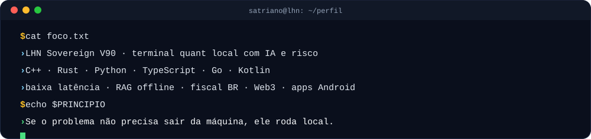</picture>

</div>

<br/>

<a id="sobre"></a>

## 👋 Sobre mim

Sou **Matheus Rodrigues Satriano**, graduando em **Ciência da Computação** e desenvolvedor de software com foco em sistemas que exigem **controle, desempenho e clareza operacional**.

Minha base é back-end, mas atuo em toda a stack quando isso melhora o produto: APIs, painéis web, motores de execução, apps Android, infraestrutura local, automação, telemetria e modelos de IA executados perto dos dados. Hoje conduzo o **ecossistema LHN Nexus** e o **CortaLive Pro**, e mantenho mais de 40 projetos abertos para estudo.

| Área | Como isso vira código | Onde ver |
|---|---|---|
| ⚡ **Baixa latência** | C++20, Rust, SIMD/AVX-512, estruturas de dados e benchmarks | [Order Book](https://github.com/SrSatriano/ultra-low-latency-order-book-engine) · [AVX-512 Pricing](https://github.com/SrSatriano/avx512-options-pricing-engine) |
| 🧠 **IA local** | RAG offline, Ollama, gateway de inferência e avaliação de LLMs | [Second Mind Vault](https://github.com/SrSatriano/local-rag-second-mind-vault) · [infergw](https://github.com/SrSatriano/distributed-ai-inference-cluster) |
| 📈 **Mercado financeiro** | order book, precificação, risco, SMC, imposto na B3 e painéis operacionais | [LHN V90](https://github.com/SrSatriano/LHN-V90-IA) · [SMC Scanner](https://github.com/SrSatriano/smc-liquidity-scanner) |
| 🌐 **Produto web** | Next.js, React, TypeScript, CSP e headers de segurança, i18n e deploy na Vercel | [lhnnexus.com](https://lhnnexus.com/pt) · [Portfólio](https://github.com/SrSatriano/portfolio-matheus-satriano) |
| 🛠️ **Infraestrutura própria** | Docker, Ansible, eBPF, GitOps e logs comprimidos, sem dependência obrigatória de nuvem | [logroute](https://github.com/SrSatriano/high-compression-log-router) · [eBPF Tracer](https://github.com/SrSatriano/ebpf-latency-tracer-financial) |
| 🇧🇷 **Soluções para o Brasil** | NF-e, IR na B3, vagas e finanças pessoais, com documentação e testes | [Fiscal OCR](https://github.com/SrSatriano/fiscal-data-ocr-engine) · [Vagas Alerta](https://github.com/SrSatriano/vagas-alerta) |

> [!TIP]
> **Princípio de engenharia:** se o problema não precisa sair da máquina, ele deve rodar localmente. A nuvem entra por necessidade técnica, não por hábito.

---

<a id="lhn-nexus"></a>

## 🌐 Ecossistema LHN Nexus

<div align="center">

<a href="https://lhnnexus.com/pt"><picture><source media="(prefers-color-scheme: dark)" srcset="assets/dark/lhn-nexus.svg" /><source media="(prefers-color-scheme: light)" srcset="assets/light/lhn-nexus.svg" /></picture></a>

<br/><br/>

<a href="https://lhnnexus.com/pt"></a>
<a href="https://lhnnexus.com/pt/finance"></a>
<a href="https://lhnnexus.com/pt/nexus"></a>
<a href="https://lhnnexus.com/pt/cortalive"></a>

</div>

O **LHN Nexus** é o portal que reúne as frentes de produto do grupo LHN em uma única experiência, publicada em **[lhnnexus.com](https://lhnnexus.com/pt)**. O lançamento oficial está marcado para **15 de fevereiro de 2027, às 00h (horário de Brasília)**; até lá, o site funciona como vitrine pública em modo seguro.

| Frente | O que entrega | Status |
|---|---|---|
| 🏛️ **[LHN Holding](https://lhnnexus.com/pt)** | visão institucional do grupo, pilares e governança das frentes | vitrine publicada |
| 📊 **[LHN Finance](https://lhnnexus.com/pt/finance)** | mesa analítica com simuladores de alocação, dividendos e risco, além de portal de notícias | demonstração com dados ilustrativos |
| 🤝 **[Nexus CRM](https://lhnnexus.com/pt/nexus)** | pipeline comercial com automação e arquitetura multiagente | demonstração · liberação no lançamento |
| ✂️ **[CortaLive Pro](https://lhnnexus.com/pt/cortalive)** | gravação de lives, cortes verticais com IA e publicação agendada | **à venda** · [detalhes abaixo](#cortalive) |

<details>
<summary><b>🔒 Engenharia por trás do site</b></summary>

<br/>

| Camada | Escolha |
|---|---|
| **Front-end** | Next.js 15 (App Router), React 19, TypeScript e Tailwind CSS |
| **Experiência** | WebGL (three.js e cobe), GSAP e Framer Motion, respeitando `prefers-reduced-motion` |
| **Idiomas** | nove idiomas no cliente, com português como base |
| **Segurança** | CSP e headers restritivos; modo vitrine *fail-closed*, em que as ferramentas só abrem com liberação explícita no servidor |
| **Back-ends** | FastAPI + SQLite com autenticação própria, fora do deploy público até o lançamento |
| **Entrega** | Vercel, com typecheck, lint, build e testes de regressão de segurança antes de cada publicação |

</details>

---

<a id="cortalive"></a>

## ✂️ CortaLive Pro

<div align="center">

<a href="https://github.com/SrSatriano/CortaLive-Basico"><picture><source media="(prefers-color-scheme: dark)" srcset="assets/dark/cortalive.svg" /><source media="(prefers-color-scheme: light)" srcset="assets/light/cortalive.svg" /></picture></a>

<br/><br/>

<a href="https://github.com/SrSatriano/CortaLive-Basico/releases/latest"></a>
<a href="https://lhnnexus.com/pt/cortalive"></a>
<a href="https://github.com/SrSatriano/CortaLive-Basico"></a>
<a href="https://github.com/SrSatriano/CortaLive-Pro/releases/latest"></a>

</div>

> [!TIP]
> **Cupom `CORTA150`:** R$ 150 de desconto no Pro até 29/11 às 23:59 (Brasília). Sai por **R$ 147** à vista ou 12x de R$ 15,27 (preço cheio: R$ 297 ou 12x de R$ 30,68). No checkout, clique em “Aplicar cupom” e digite o código.

**Você escolhe os canais; o CortaLive Pro grava a live, identifica os melhores momentos e publica o corte.** Ele cruza o volume do áudio com o movimento do chat para achar os picos, transcreve no seu PC com Whisper (o áudio não sai da máquina), deixa a IA dar nota de 0 a 10 e escrever título, legenda e hashtags, e corta em vertical com o rosto do streamer em cima, legenda palavra a palavra e crédito ao criador. Depois publica no TikTok, no YouTube Shorts e no Instagram Reels nos horários da sua grade. O **Básico**, grátis e de código aberto, faz a parte do corte com vídeos que você já gravou.

<table>
<tr>
<td width="34%" align="center" valign="top">

<a href="https://lhnnexus.com/pt/cortalive"></a>

<sub>▶ <a href="https://lhnnexus.com/pt/cortalive">Ver o vídeo de 50 s</a> · telas reais, dados de demonstração</sub>

</td>
<td valign="top">

### 📡 Em produção

O CortaLive nasceu para o meu canal de cortes de games, o **Afiado Games**. Desde **18/11/2026**, as publicações do canal são feitas pelo próprio Pro, rodando no meu PC. Os resultados podem ser conferidos publicamente:

<a href="https://www.tiktok.com/@afiado.games"></a>
<a href="https://www.youtube.com/@AfiadoGames"></a>
<a href="https://www.instagram.com/afiadogames/"></a>

| Etapa | O que o Pro faz |
|---|---|
| 🎥 **grava** | cola o link do canal (Twitch, YouTube ou Kick) e ele grava em blocos de 5 min, junto com o chat; também procura lives de um jogo |
| 🎯 **escolhe** | áudio + chat acham os picos; abaixo da nota mínima que você definiu, não vira corte |
| ✂️ **corta** | vertical até 4K, com duração e resolução ajustáveis |
| 📤 **posta** | grade de horários por rede; TikTok só recebe cortes acima de 1:10 e Shorts/Reels até 3 min; pausa geral ou por rede |
| 📊 **acompanha** | painel com o que está gravando, fila, próximos posts, métricas e análise |

</td>
</tr>
</table>

<table>
<tr>
<td width="50%"><a href="https://lhnnexus.com/pt/cortalive">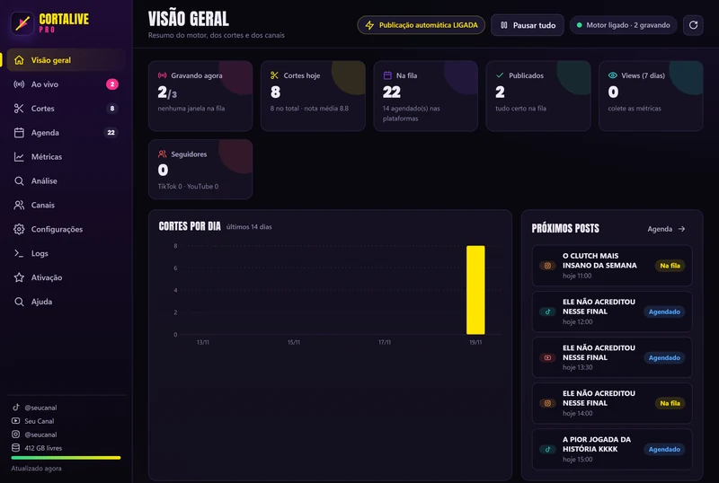</a><br/><sub><b>Visão geral:</b> gravando agora, cortes do dia, fila e próximos posts</sub></td>
<td width="50%"><a href="https://lhnnexus.com/pt/cortalive">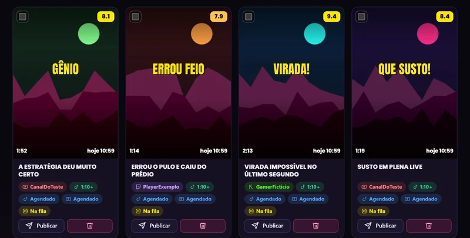</a><br/><sub><b>Cortes:</b> cada corte com a nota da IA, título e status por rede</sub></td>
</tr>
<tr>
<td width="50%"><a href="https://lhnnexus.com/pt/cortalive">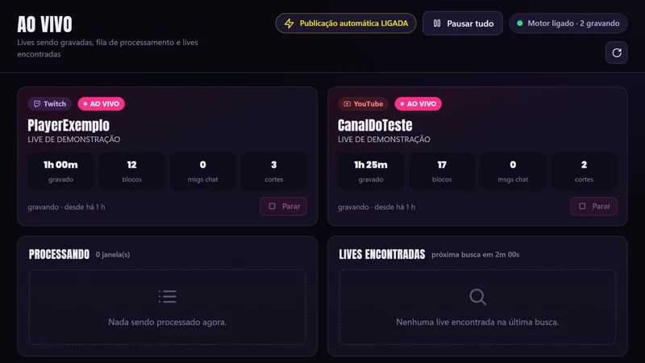</a><br/><sub><b>Ao vivo:</b> lives sendo gravadas, blocos e mensagens do chat</sub></td>
<td width="50%"><a href="https://lhnnexus.com/pt/cortalive">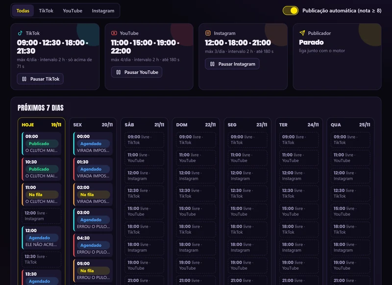</a><br/><sub><b>Agenda:</b> horários por rede e os próximos 7 dias</sub></td>
</tr>
</table>

<sub>Telas do programa com dados de demonstração no lugar dos canais reais.</sub>

| | 🟢 [Básico](https://github.com/SrSatriano/CortaLive-Basico) | 🟠 [Pro](https://lhnnexus.com/pt/cortalive) |
|---|:---:|:---:|
| Corta vídeo ou live que você já gravou | ✅ | ✅ |
| IA escolhe os momentos e escreve título, legenda e hashtags | ✅ | ✅ |
| Legenda palavra a palavra, capa e crédito ao criador | ✅ | ✅ |
| Resolução do corte | 1080x1920 | até 4K (2160x3840) |
| Usa o **chat** para achar os picos | | ✅ |
| **Grava lives sozinho** (Twitch, YouTube, Kick) | | ✅ |
| **Publica** no TikTok, Shorts e Reels | | ✅ |
| Agenda, pausa por rede, métricas e análise | | ✅ |
| Código aberto | ✅ MIT | |
| Licença | livre | vitalícia, até 2 PCs · reembolso em 7 dias |
| Preço | **grátis** | ~~R$ 297~~ **R$ 147**<br/><sub>com o cupom <code>CORTA150</code> até 29/11</sub> |
| Suporte | Issues | e-mail |

<sub>Windows 10/11 (64 bits) · não precisa de placa de vídeo nem saber editar · IA opcional com a sua chave (Gemini, Vertex, Claude ou OpenAI); sem chave, ele escolhe só pelos picos · Pro: pagamento pela Cakto, ativação automática com o e-mail da compra · <a href="https://lhnnexus.com/pt/cortalive/instalar">guia de instalação</a></sub>

<br/>

<div align="center">

### 🧭 Navegue pelas frentes

<a href="#frente-quant"><picture><source media="(prefers-color-scheme: dark)" srcset="assets/dark/nav/quant.svg" /><source media="(prefers-color-scheme: light)" srcset="assets/light/nav/quant.svg" />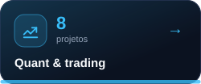</picture></a>
<a href="#frente-ai"><picture><source media="(prefers-color-scheme: dark)" srcset="assets/dark/nav/ai.svg" /><source media="(prefers-color-scheme: light)" srcset="assets/light/nav/ai.svg" />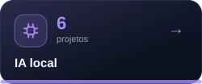</picture></a>
<a href="#frente-media"><picture><source media="(prefers-color-scheme: dark)" srcset="assets/dark/nav/media.svg" /><source media="(prefers-color-scheme: light)" srcset="assets/light/nav/media.svg" />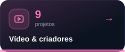</picture></a>
<a href="#frente-product"><picture><source media="(prefers-color-scheme: dark)" srcset="assets/dark/nav/product.svg" /><source media="(prefers-color-scheme: light)" srcset="assets/light/nav/product.svg" /></picture></a>
<a href="#frente-web3"><picture><source media="(prefers-color-scheme: dark)" srcset="assets/dark/nav/web3.svg" /><source media="(prefers-color-scheme: light)" srcset="assets/light/nav/web3.svg" />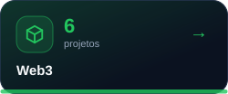</picture></a>
<a href="#frente-infra"><picture><source media="(prefers-color-scheme: dark)" srcset="assets/dark/nav/infra.svg" /><source media="(prefers-color-scheme: light)" srcset="assets/light/nav/infra.svg" />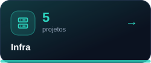</picture></a>
<a href="#frente-origins"><picture><source media="(prefers-color-scheme: dark)" srcset="assets/dark/nav/origins.svg" /><source media="(prefers-color-scheme: light)" srcset="assets/light/nav/origins.svg" />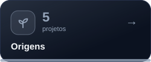</picture></a>
<a href="#indice"><picture><source media="(prefers-color-scheme: dark)" srcset="assets/dark/nav/indice.svg" /><source media="(prefers-color-scheme: light)" srcset="assets/light/nav/indice.svg" />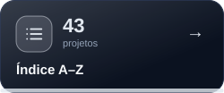</picture></a>

<br/>

<sub>
<a href="#sobre">👋 Sobre</a> ·
<a href="#lhn-nexus">🌐 LHN Nexus</a> ·
<a href="#cortalive">✂️ CortaLive Pro</a> ·
<a href="#em-numeros">📊 Em números</a> ·
<a href="#lhn-sovereign-v90">🛰️ LHN V90</a> ·
<a href="#destaques">⭐ Destaques</a> ·
<a href="#catalogo">🗂️ Catálogo</a> ·
<a href="#ecossistema">🔗 Mapa dos projetos</a> ·
<a href="#por-onde-comecar">🧑‍💻 Por onde começar</a> ·
<a href="#stack">🧰 Stack</a> ·
<a href="#atividade">📈 Atividade</a> ·
<a href="#contato">📬 Contato</a>
</sub>

</div>

---

<a id="em-numeros"></a>

## 📊 Em números

<div align="center">

<picture><source media="(prefers-color-scheme: dark)" srcset="assets/dark/overview.svg" /><source media="(prefers-color-scheme: light)" srcset="assets/light/overview.svg" />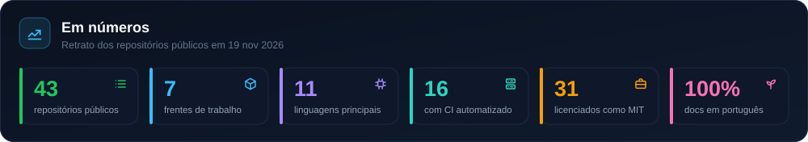</picture>

<picture><source media="(prefers-color-scheme: dark)" srcset="assets/dark/categories.svg" /><source media="(prefers-color-scheme: light)" srcset="assets/light/categories.svg" />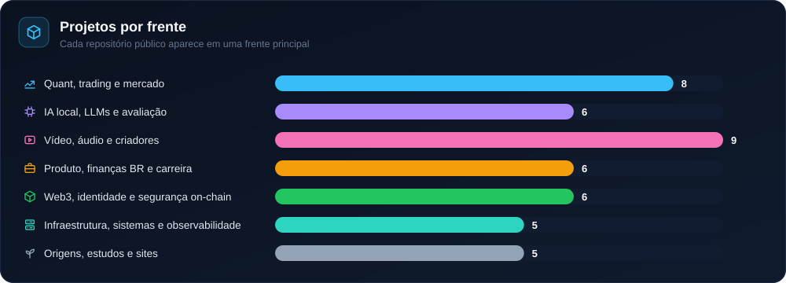</picture>

<table>
<tr>
<td width="50%"><picture><source media="(prefers-color-scheme: dark)" srcset="assets/dark/languages.svg" /><source media="(prefers-color-scheme: light)" srcset="assets/light/languages.svg" />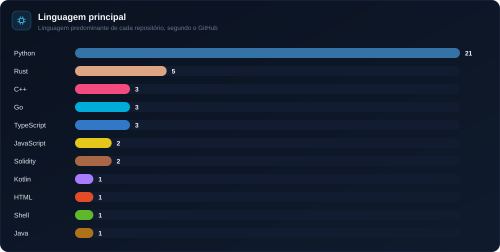</picture></td>
<td width="50%"><picture><source media="(prefers-color-scheme: dark)" srcset="assets/dark/timeline.svg" /><source media="(prefers-color-scheme: light)" srcset="assets/light/timeline.svg" />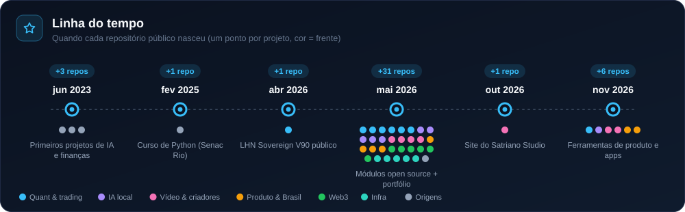</picture></td>
</tr>
</table>

</div>

---

<a id="lhn-sovereign-v90"></a>

## 🛰️ LHN Sovereign V90

<table>
<tr>
<td width="52%" valign="top">

**LHN Sovereign V90** é meu terminal quantitativo local para pesquisa, automação controlada e operação assistida em cripto.

Ele combina **FastAPI**, **Next.js**, integração com **Bybit V5** (REST + WebSocket), camadas de risco, workspace local e módulos de IA em Keras/TensorFlow. A ideia central: manter o operador no controle, reduzir dependências externas e deixar o sistema observável.

| Camada | Papel |
|---|---|
| 🖥️ **Painel** | leitura de estado, parâmetros e operação |
| 🔌 **API** | orquestração, configuração, risco, execução e integração |
| ⚙️ **Core** | decisão, replay, backfill, radar, labeler e ciclo de treino |
| 🧠 **IA local** | inferência e análise perto dos dados |
| 🗄️ **Workspace** | persistência, auditoria, logs e artefatos |
| 📱 **Mirror** | painel remoto no Android ([lhn-android-apps](https://github.com/SrSatriano/lhn-android-apps)) |

> **Licença:** PolyForm Noncommercial. O código é público para estudo, mas não é MIT.

</td>
<td width="48%" valign="top" align="center">

<a href="https://github.com/SrSatriano/LHN-V90-IA"><picture><source media="(prefers-color-scheme: dark)" srcset="assets/dark/cards/LHN-V90-IA.svg" /><source media="(prefers-color-scheme: light)" srcset="assets/light/cards/LHN-V90-IA.svg" />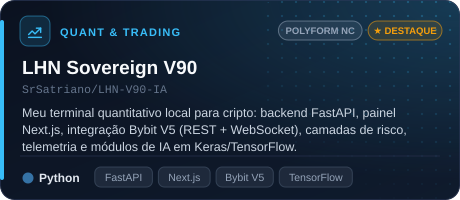</picture></a>

<br/><br/>

<a href="https://github.com/SrSatriano/LHN-V90-IA"></a>


</td>
</tr>
</table>

<div align="center">

<picture><source media="(prefers-color-scheme: dark)" srcset="assets/dark/lhn-architecture.svg" /><source media="(prefers-color-scheme: light)" srcset="assets/light/lhn-architecture.svg" />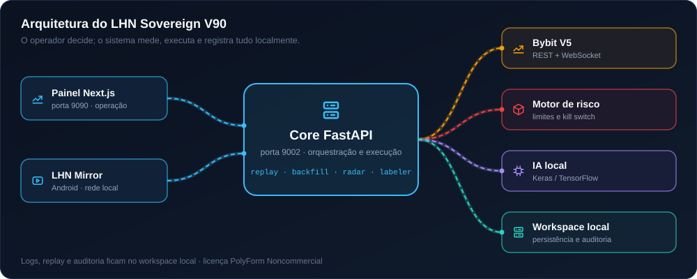</picture>

</div>

---

<a id="destaques"></a>

## ⭐ Destaques

Uma seleção dos projetos mais representativos do meu trabalho. Cada card abre o repositório correspondente.

<div align="center">

<table>
<tr><td width="50%"><a href="https://github.com/SrSatriano/CortaLive-Basico"><picture><source media="(prefers-color-scheme: dark)" srcset="assets/dark/cards/CortaLive-Basico.svg" /><source media="(prefers-color-scheme: light)" srcset="assets/light/cards/CortaLive-Basico.svg" />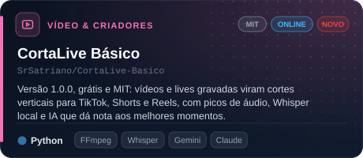</picture></a></td><td width="50%"><a href="https://github.com/SrSatriano/CortaLive-Pro"><picture><source media="(prefers-color-scheme: dark)" srcset="assets/dark/cards/CortaLive-Pro.svg" /><source media="(prefers-color-scheme: light)" srcset="assets/light/cards/CortaLive-Pro.svg" />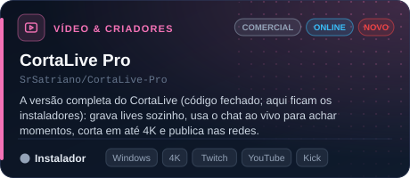</picture></a></td></tr>
<tr><td width="50%"><a href="https://github.com/SrSatriano/lhn-android-apps"><picture><source media="(prefers-color-scheme: dark)" srcset="assets/dark/cards/lhn-android-apps.svg" /><source media="(prefers-color-scheme: light)" srcset="assets/light/cards/lhn-android-apps.svg" />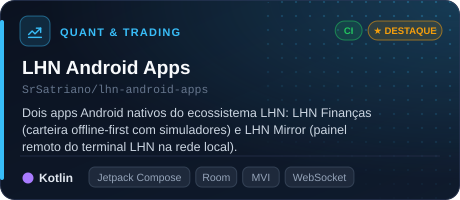</picture></a></td><td width="50%"><a href="https://github.com/SrSatriano/ultra-low-latency-order-book-engine"><picture><source media="(prefers-color-scheme: dark)" srcset="assets/dark/cards/ultra-low-latency-order-book-engine.svg" /><source media="(prefers-color-scheme: light)" srcset="assets/light/cards/ultra-low-latency-order-book-engine.svg" />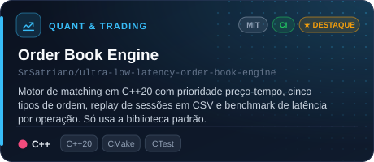</picture></a></td></tr>
<tr><td width="50%"><a href="https://github.com/SrSatriano/avx512-options-pricing-engine"><picture><source media="(prefers-color-scheme: dark)" srcset="assets/dark/cards/avx512-options-pricing-engine.svg" /><source media="(prefers-color-scheme: light)" srcset="assets/light/cards/avx512-options-pricing-engine.svg" />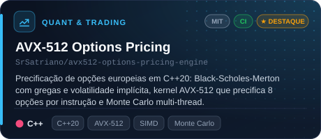</picture></a></td><td width="50%"><a href="https://github.com/SrSatriano/local-rag-second-mind-vault"><picture><source media="(prefers-color-scheme: dark)" srcset="assets/dark/cards/local-rag-second-mind-vault.svg" /><source media="(prefers-color-scheme: light)" srcset="assets/light/cards/local-rag-second-mind-vault.svg" />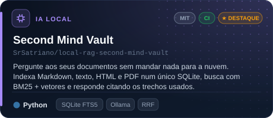</picture></a></td></tr>
<tr><td width="50%"><a href="https://github.com/SrSatriano/distributed-ai-inference-cluster"><picture><source media="(prefers-color-scheme: dark)" srcset="assets/dark/cards/distributed-ai-inference-cluster.svg" /><source media="(prefers-color-scheme: light)" srcset="assets/light/cards/distributed-ai-inference-cluster.svg" />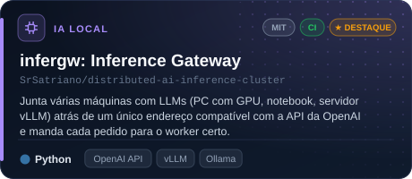</picture></a></td><td width="50%"><a href="https://github.com/SrSatriano/videoos"><picture><source media="(prefers-color-scheme: dark)" srcset="assets/dark/cards/videoos.svg" /><source media="(prefers-color-scheme: light)" srcset="assets/light/cards/videoos.svg" />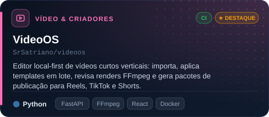</picture></a></td></tr>
<tr><td width="50%"><a href="https://github.com/SrSatriano/fiscal-data-ocr-engine"><picture><source media="(prefers-color-scheme: dark)" srcset="assets/dark/cards/fiscal-data-ocr-engine.svg" /><source media="(prefers-color-scheme: light)" srcset="assets/light/cards/fiscal-data-ocr-engine.svg" />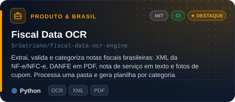</picture></a></td><td width="50%"><a href="https://github.com/SrSatriano/vagas-alerta"><picture><source media="(prefers-color-scheme: dark)" srcset="assets/dark/cards/vagas-alerta.svg" /><source media="(prefers-color-scheme: light)" srcset="assets/light/cards/vagas-alerta.svg" />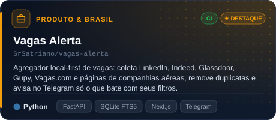</picture></a></td></tr>
<tr><td width="50%"><a href="https://github.com/SrSatriano/high-compression-log-router"><picture><source media="(prefers-color-scheme: dark)" srcset="assets/dark/cards/high-compression-log-router.svg" /><source media="(prefers-color-scheme: light)" srcset="assets/light/cards/high-compression-log-router.svg" />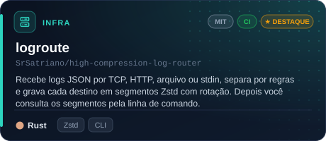</picture></a></td></tr>
</table>

</div>

---

<a id="catalogo"></a>

## 🗂️ Catálogo completo

Todos os 45 repositórios públicos, agrupados por frente. À esquerda, o card (clique para abrir); à direita, os destaques técnicos, a stack, o status do CI e os links úteis.

> [!NOTE]
> **Selos nos cards:** `NOVO` lançado agora · `★ DESTAQUE` bom ponto de partida · `CI` testes no GitHub Actions · `ONLINE` tem site publicado · `MIT` / `POLYFORM NC` licença.

<a id="frente-quant"></a>

<picture><source media="(prefers-color-scheme: dark)" srcset="assets/dark/sections/quant.svg" /><source media="(prefers-color-scheme: light)" srcset="assets/light/sections/quant.svg" />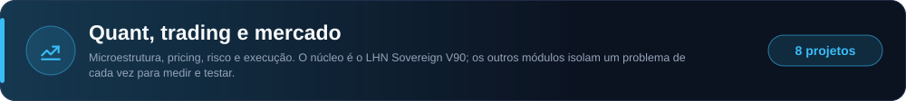</picture>

<details open>
<summary><b>📈 Quant, trading e mercado: ver os 8 projetos</b></summary>
<br/>

<table>
<tr>
<td width="48%" valign="top"><a href="https://github.com/SrSatriano/LHN-V90-IA"><picture><source media="(prefers-color-scheme: dark)" srcset="assets/dark/cards/LHN-V90-IA.svg" /><source media="(prefers-color-scheme: light)" srcset="assets/light/cards/LHN-V90-IA.svg" /></picture></a></td>
<td valign="top">

<h4><a href="https://github.com/SrSatriano/LHN-V90-IA">LHN Sovereign V90</a></h4>
 
<ul>
<li>Operador no controle: risco, execução e auditoria visíveis no painel</li>
<li>Replay, backfill, radar, labeler e ciclo de treino no core</li>
<li>Source-available sob PolyForm Noncommercial</li>
</ul>
<sub><b>Stack:</b> <code>Python</code> <code>FastAPI</code> <code>Next.js</code> <code>Bybit V5</code> <code>TensorFlow</code></sub><br/>
<sub><a href="https://github.com/SrSatriano/LHN-V90-IA">📂 Código</a> · <a href="https://github.com/SrSatriano/LHN-V90-IA#readme">📖 README</a> · <a href="https://github.com/SrSatriano/LHN-V90-IA/commits">🕒 Commits</a> · <a href="https://github.com/SrSatriano/LHN-V90-IA/issues">💬 Issues</a></sub>

</td>
</tr>
<tr>
<td width="48%" valign="top"><a href="https://github.com/SrSatriano/lhn-android-apps"><picture><source media="(prefers-color-scheme: dark)" srcset="assets/dark/cards/lhn-android-apps.svg" /><source media="(prefers-color-scheme: light)" srcset="assets/light/cards/lhn-android-apps.svg" /></picture></a></td>
<td valign="top">

<h4><a href="https://github.com/SrSatriano/lhn-android-apps">LHN Android Apps</a></h4>
<a href="https://github.com/SrSatriano/lhn-android-apps/actions/workflows/ci.yml"></a> 
<ul>
<li>Carteira com B3, exterior, FIIs, Tesouro Direto e cripto</li>
<li>Simuladores FIRE, juros compostos, comprar ou alugar e DARF</li>
<li>Mirror com biometria, WorkManager e descoberta automática do servidor</li>
</ul>
<sub><b>Stack:</b> <code>Kotlin</code> <code>Jetpack Compose</code> <code>Room</code> <code>MVI</code> <code>WebSocket</code></sub><br/>
<sub><a href="https://github.com/SrSatriano/lhn-android-apps">📂 Código</a> · <a href="https://github.com/SrSatriano/lhn-android-apps#readme">📖 README</a> · <a href="https://github.com/SrSatriano/lhn-android-apps/commits">🕒 Commits</a> · <a href="https://github.com/SrSatriano/lhn-android-apps/issues">💬 Issues</a></sub>

</td>
</tr>
<tr>
<td width="48%" valign="top"><a href="https://github.com/SrSatriano/ultra-low-latency-order-book-engine"><picture><source media="(prefers-color-scheme: dark)" srcset="assets/dark/cards/ultra-low-latency-order-book-engine.svg" /><source media="(prefers-color-scheme: light)" srcset="assets/light/cards/ultra-low-latency-order-book-engine.svg" /></picture></a></td>
<td valign="top">

<h4><a href="https://github.com/SrSatriano/ultra-low-latency-order-book-engine">Order Book Engine</a></h4>
<a href="https://github.com/SrSatriano/ultra-low-latency-order-book-engine/actions/workflows/ci.yml"></a>  
<ul>
<li>Prioridade preço-tempo; o agressor executa ao preço do maker</li>
<li>Replay determinístico de sessões em CSV</li>
<li>Benchmark de latência por operação</li>
</ul>
<sub><b>Stack:</b> <code>C++20</code> <code>CMake</code> <code>CTest</code></sub><br/>
<sub><a href="https://github.com/SrSatriano/ultra-low-latency-order-book-engine">📂 Código</a> · <a href="https://github.com/SrSatriano/ultra-low-latency-order-book-engine#readme">📖 README</a> · <a href="https://github.com/SrSatriano/ultra-low-latency-order-book-engine/commits">🕒 Commits</a> · <a href="https://github.com/SrSatriano/ultra-low-latency-order-book-engine/issues">💬 Issues</a></sub>

</td>
</tr>
<tr>
<td width="48%" valign="top"><a href="https://github.com/SrSatriano/avx512-options-pricing-engine"><picture><source media="(prefers-color-scheme: dark)" srcset="assets/dark/cards/avx512-options-pricing-engine.svg" /><source media="(prefers-color-scheme: light)" srcset="assets/light/cards/avx512-options-pricing-engine.svg" /></picture></a></td>
<td valign="top">

<h4><a href="https://github.com/SrSatriano/avx512-options-pricing-engine">AVX-512 Options Pricing</a></h4>
<a href="https://github.com/SrSatriano/avx512-options-pricing-engine/actions/workflows/ci.yml"></a>  
<ul>
<li>exp, log e erfc vetoriais próprios, sem SVML</li>
<li>Monte Carlo com variáveis antitéticas</li>
<li>Sem dependências externas e sem GPU</li>
</ul>
<sub><b>Stack:</b> <code>C++20</code> <code>AVX-512</code> <code>SIMD</code> <code>Monte Carlo</code></sub><br/>
<sub><a href="https://github.com/SrSatriano/avx512-options-pricing-engine">📂 Código</a> · <a href="https://github.com/SrSatriano/avx512-options-pricing-engine#readme">📖 README</a> · <a href="https://github.com/SrSatriano/avx512-options-pricing-engine/commits">🕒 Commits</a> · <a href="https://github.com/SrSatriano/avx512-options-pricing-engine/issues">💬 Issues</a></sub>

</td>
</tr>
<tr>
<td width="48%" valign="top"><a href="https://github.com/SrSatriano/smc-liquidity-scanner"><picture><source media="(prefers-color-scheme: dark)" srcset="assets/dark/cards/smc-liquidity-scanner.svg" /><source media="(prefers-color-scheme: light)" srcset="assets/light/cards/smc-liquidity-scanner.svg" />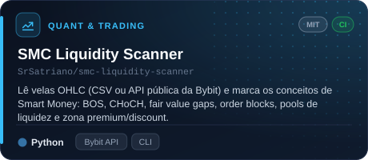</picture></a></td>
<td valign="top">

<h4><a href="https://github.com/SrSatriano/smc-liquidity-scanner">SMC Liquidity Scanner</a></h4>
<a href="https://github.com/SrSatriano/smc-liquidity-scanner/actions/workflows/ci.yml"></a>  
<ul>
<li>FVG com acompanhamento de mitigação e preenchimento</li>
<li>Detecção de varreduras de liquidez</li>
<li>Saída em terminal, JSON ou gráfico HTML</li>
</ul>
<sub><b>Stack:</b> <code>Python</code> <code>Bybit API</code> <code>CLI</code></sub><br/>
<sub><a href="https://github.com/SrSatriano/smc-liquidity-scanner">📂 Código</a> · <a href="https://github.com/SrSatriano/smc-liquidity-scanner#readme">📖 README</a> · <a href="https://github.com/SrSatriano/smc-liquidity-scanner/commits">🕒 Commits</a> · <a href="https://github.com/SrSatriano/smc-liquidity-scanner/issues">💬 Issues</a></sub>

</td>
</tr>
<tr>
<td width="48%" valign="top"><a href="https://github.com/SrSatriano/unified-trading-super-terminal"><picture><source media="(prefers-color-scheme: dark)" srcset="assets/dark/cards/unified-trading-super-terminal.svg" /><source media="(prefers-color-scheme: light)" srcset="assets/light/cards/unified-trading-super-terminal.svg" />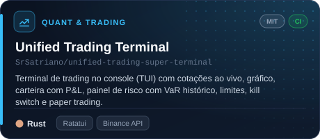</picture></a></td>
<td valign="top">

<h4><a href="https://github.com/SrSatriano/unified-trading-super-terminal">Unified Trading Terminal</a></h4>
<a href="https://github.com/SrSatriano/unified-trading-super-terminal/actions/workflows/ci.yml"></a>  
<ul>
<li>Dados públicos da Binance, sem chave de API</li>
<li>Simulador determinístico para testes</li>
<li>VaR histórico e kill switch</li>
</ul>
<sub><b>Stack:</b> <code>Rust</code> <code>Ratatui</code> <code>Binance API</code></sub><br/>
<sub><a href="https://github.com/SrSatriano/unified-trading-super-terminal">📂 Código</a> · <a href="https://github.com/SrSatriano/unified-trading-super-terminal#readme">📖 README</a> · <a href="https://github.com/SrSatriano/unified-trading-super-terminal/commits">🕒 Commits</a> · <a href="https://github.com/SrSatriano/unified-trading-super-terminal/issues">💬 Issues</a></sub>

</td>
</tr>
<tr>
<td width="48%" valign="top"><a href="https://github.com/SrSatriano/dark-pool-market-impact-simulator"><picture><source media="(prefers-color-scheme: dark)" srcset="assets/dark/cards/dark-pool-market-impact-simulator.svg" /><source media="(prefers-color-scheme: light)" srcset="assets/light/cards/dark-pool-market-impact-simulator.svg" />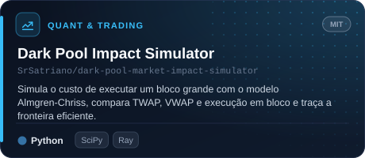</picture></a></td>
<td valign="top">

<h4><a href="https://github.com/SrSatriano/dark-pool-market-impact-simulator">Dark Pool Impact Simulator</a></h4>
 
<ul>
<li>Modelo Almgren-Chriss calibrado com histórico</li>
<li>Comparativo TWAP / VWAP / block</li>
<li>Cenários em lote paralelizados com Ray</li>
</ul>
<sub><b>Stack:</b> <code>Python</code> <code>SciPy</code> <code>Ray</code></sub><br/>
<sub><a href="https://github.com/SrSatriano/dark-pool-market-impact-simulator">📂 Código</a> · <a href="https://github.com/SrSatriano/dark-pool-market-impact-simulator#readme">📖 README</a> · <a href="https://github.com/SrSatriano/dark-pool-market-impact-simulator/commits">🕒 Commits</a> · <a href="https://github.com/SrSatriano/dark-pool-market-impact-simulator/issues">💬 Issues</a></sub>

</td>
</tr>
<tr>
<td width="48%" valign="top"><a href="https://github.com/SrSatriano/chaos-engineering-trading-toolkit"><picture><source media="(prefers-color-scheme: dark)" srcset="assets/dark/cards/chaos-engineering-trading-toolkit.svg" /><source media="(prefers-color-scheme: light)" srcset="assets/light/cards/chaos-engineering-trading-toolkit.svg" />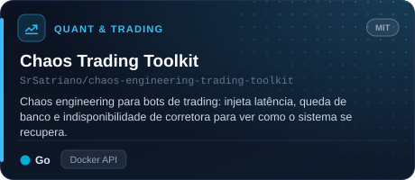</picture></a></td>
<td valign="top">

<h4><a href="https://github.com/SrSatriano/chaos-engineering-trading-toolkit">Chaos Trading Toolkit</a></h4>
 
<ul>
<li>CLI chaosd com experimentos documentados</li>
<li>Relatórios de recuperação e MTTR</li>
<li>Integração com a API do Docker</li>
</ul>
<sub><b>Stack:</b> <code>Go</code> <code>Docker API</code></sub><br/>
<sub><a href="https://github.com/SrSatriano/chaos-engineering-trading-toolkit">📂 Código</a> · <a href="https://github.com/SrSatriano/chaos-engineering-trading-toolkit#readme">📖 README</a> · <a href="https://github.com/SrSatriano/chaos-engineering-trading-toolkit/commits">🕒 Commits</a> · <a href="https://github.com/SrSatriano/chaos-engineering-trading-toolkit/issues">💬 Issues</a></sub>

</td>
</tr>
</table>

</details>

<p align="right"><a href="#topo">⬆ voltar ao topo</a></p>

<a id="frente-ai"></a>

<picture><source media="(prefers-color-scheme: dark)" srcset="assets/dark/sections/ai.svg" /><source media="(prefers-color-scheme: light)" srcset="assets/light/sections/ai.svg" />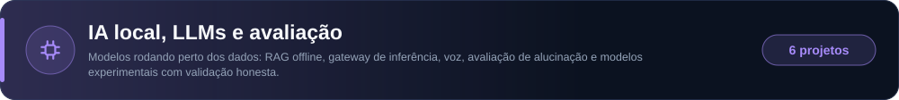</picture>

<details open>
<summary><b>🧠 IA local, LLMs e avaliação: ver os 6 projetos</b></summary>
<br/>

<table>
<tr>
<td width="48%" valign="top"><a href="https://github.com/SrSatriano/local-rag-second-mind-vault"><picture><source media="(prefers-color-scheme: dark)" srcset="assets/dark/cards/local-rag-second-mind-vault.svg" /><source media="(prefers-color-scheme: light)" srcset="assets/light/cards/local-rag-second-mind-vault.svg" /></picture></a></td>
<td valign="top">

<h4><a href="https://github.com/SrSatriano/local-rag-second-mind-vault">Second Mind Vault</a></h4>
<a href="https://github.com/SrSatriano/local-rag-second-mind-vault/actions/workflows/ci.yml"></a>  
<ul>
<li>Fusão BM25 + vetores por Reciprocal Rank Fusion</li>
<li>Resposta gerada pelo Ollama local, com citações</li>
<li>Sem Ollama, devolve os trechos em vez de inventar</li>
</ul>
<sub><b>Stack:</b> <code>Python</code> <code>SQLite FTS5</code> <code>Ollama</code> <code>RRF</code></sub><br/>
<sub><a href="https://github.com/SrSatriano/local-rag-second-mind-vault">📂 Código</a> · <a href="https://github.com/SrSatriano/local-rag-second-mind-vault#readme">📖 README</a> · <a href="https://github.com/SrSatriano/local-rag-second-mind-vault/commits">🕒 Commits</a> · <a href="https://github.com/SrSatriano/local-rag-second-mind-vault/issues">💬 Issues</a></sub>

</td>
</tr>
<tr>
<td width="48%" valign="top"><a href="https://github.com/SrSatriano/distributed-ai-inference-cluster"><picture><source media="(prefers-color-scheme: dark)" srcset="assets/dark/cards/distributed-ai-inference-cluster.svg" /><source media="(prefers-color-scheme: light)" srcset="assets/light/cards/distributed-ai-inference-cluster.svg" /></picture></a></td>
<td valign="top">

<h4><a href="https://github.com/SrSatriano/distributed-ai-inference-cluster">infergw: Inference Gateway</a></h4>
<a href="https://github.com/SrSatriano/distributed-ai-inference-cluster/actions/workflows/ci.yml"></a>  
<ul>
<li>Roteamento por modelo anunciado em /v1/models</li>
<li>Balanceamento por ocupação, fila e tolerância a falhas</li>
<li>Funciona com Ollama, vLLM e servidores OpenAI-compatíveis</li>
</ul>
<sub><b>Stack:</b> <code>Python</code> <code>OpenAI API</code> <code>vLLM</code> <code>Ollama</code></sub><br/>
<sub><a href="https://github.com/SrSatriano/distributed-ai-inference-cluster">📂 Código</a> · <a href="https://github.com/SrSatriano/distributed-ai-inference-cluster#readme">📖 README</a> · <a href="https://github.com/SrSatriano/distributed-ai-inference-cluster/commits">🕒 Commits</a> · <a href="https://github.com/SrSatriano/distributed-ai-inference-cluster/issues">💬 Issues</a></sub>

</td>
</tr>
<tr>
<td width="48%" valign="top"><a href="https://github.com/SrSatriano/loteria-ia"><picture><source media="(prefers-color-scheme: dark)" srcset="assets/dark/cards/loteria-ia.svg" /><source media="(prefers-color-scheme: light)" srcset="assets/light/cards/loteria-ia.svg" />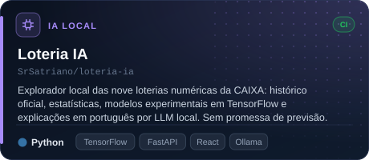</picture></a></td>
<td valign="top">

<h4><a href="https://github.com/SrSatriano/loteria-ia">Loteria IA</a></h4>
<a href="https://github.com/SrSatriano/loteria-ia/actions/workflows/quality.yml"></a> 
<ul>
<li>Modelo só é promovido se não piorar contra a baseline</li>
<li>Chance matemática exata embaixo de cada aposta</li>
<li>Docker Compose com FastAPI, React e Ollama</li>
</ul>
<sub><b>Stack:</b> <code>Python</code> <code>TensorFlow</code> <code>FastAPI</code> <code>React</code> <code>Ollama</code></sub><br/>
<sub><a href="https://github.com/SrSatriano/loteria-ia">📂 Código</a> · <a href="https://github.com/SrSatriano/loteria-ia#readme">📖 README</a> · <a href="https://github.com/SrSatriano/loteria-ia/commits">🕒 Commits</a> · <a href="https://github.com/SrSatriano/loteria-ia/issues">💬 Issues</a></sub>

</td>
</tr>
<tr>
<td width="48%" valign="top"><a href="https://github.com/SrSatriano/cognitive-bias-hallucination-trap"><picture><source media="(prefers-color-scheme: dark)" srcset="assets/dark/cards/cognitive-bias-hallucination-trap.svg" /><source media="(prefers-color-scheme: light)" srcset="assets/light/cards/cognitive-bias-hallucination-trap.svg" />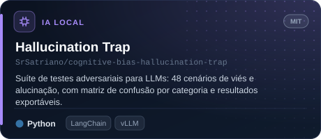</picture></a></td>
<td valign="top">

<h4><a href="https://github.com/SrSatriano/cognitive-bias-hallucination-trap">Hallucination Trap</a></h4>
 
<ul>
<li>48 traps categorizados</li>
<li>Integração com vLLM OpenAI-compatible</li>
<li>Gate de release e comparação de temperaturas</li>
</ul>
<sub><b>Stack:</b> <code>Python</code> <code>LangChain</code> <code>vLLM</code></sub><br/>
<sub><a href="https://github.com/SrSatriano/cognitive-bias-hallucination-trap">📂 Código</a> · <a href="https://github.com/SrSatriano/cognitive-bias-hallucination-trap#readme">📖 README</a> · <a href="https://github.com/SrSatriano/cognitive-bias-hallucination-trap/commits">🕒 Commits</a> · <a href="https://github.com/SrSatriano/cognitive-bias-hallucination-trap/issues">💬 Issues</a></sub>

</td>
</tr>
<tr>
<td width="48%" valign="top"><a href="https://github.com/SrSatriano/voice-cloning-tts-api-gateway"><picture><source media="(prefers-color-scheme: dark)" srcset="assets/dark/cards/voice-cloning-tts-api-gateway.svg" /><source media="(prefers-color-scheme: light)" srcset="assets/light/cards/voice-cloning-tts-api-gateway.svg" />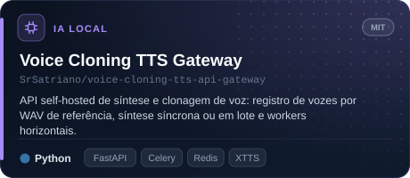</picture></a></td>
<td valign="top">

<h4><a href="https://github.com/SrSatriano/voice-cloning-tts-api-gateway">Voice Cloning TTS Gateway</a></h4>
 
<ul>
<li>Swagger UI interativo</li>
<li>Workers escaláveis com Celery + Redis</li>
<li>Guia de fine-tuning e qualidade de áudio</li>
</ul>
<sub><b>Stack:</b> <code>Python</code> <code>FastAPI</code> <code>Celery</code> <code>Redis</code> <code>XTTS</code></sub><br/>
<sub><a href="https://github.com/SrSatriano/voice-cloning-tts-api-gateway">📂 Código</a> · <a href="https://github.com/SrSatriano/voice-cloning-tts-api-gateway#readme">📖 README</a> · <a href="https://github.com/SrSatriano/voice-cloning-tts-api-gateway/commits">🕒 Commits</a> · <a href="https://github.com/SrSatriano/voice-cloning-tts-api-gateway/issues">💬 Issues</a></sub>

</td>
</tr>
<tr>
<td width="48%" valign="top"><a href="https://github.com/SrSatriano/viral-trend-sentiment-predictor"><picture><source media="(prefers-color-scheme: dark)" srcset="assets/dark/cards/viral-trend-sentiment-predictor.svg" /><source media="(prefers-color-scheme: light)" srcset="assets/light/cards/viral-trend-sentiment-predictor.svg" />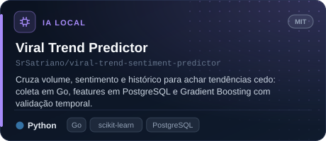</picture></a></td>
<td valign="top">

<h4><a href="https://github.com/SrSatriano/viral-trend-sentiment-predictor">Viral Trend Predictor</a></h4>
 
<ul>
<li>Séries temporais de views e sentimento</li>
<li>Split temporal, sem vazamento de futuro</li>
<li>Ranking diário de nichos e alertas de breakout</li>
</ul>
<sub><b>Stack:</b> <code>Go</code> <code>Python</code> <code>scikit-learn</code> <code>PostgreSQL</code></sub><br/>
<sub><a href="https://github.com/SrSatriano/viral-trend-sentiment-predictor">📂 Código</a> · <a href="https://github.com/SrSatriano/viral-trend-sentiment-predictor#readme">📖 README</a> · <a href="https://github.com/SrSatriano/viral-trend-sentiment-predictor/commits">🕒 Commits</a> · <a href="https://github.com/SrSatriano/viral-trend-sentiment-predictor/issues">💬 Issues</a></sub>

</td>
</tr>
</table>

</details>

<p align="right"><a href="#topo">⬆ voltar ao topo</a></p>

<a id="frente-media"></a>

<picture><source media="(prefers-color-scheme: dark)" srcset="assets/dark/sections/media.svg" /><source media="(prefers-color-scheme: light)" srcset="assets/light/sections/media.svg" />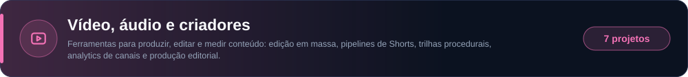</picture>

<details open>
<summary><b>🎬 Vídeo, áudio e criadores: ver os 9 projetos</b></summary>
<br/>

<table>
<tr>
<td width="48%" valign="top"><a href="https://github.com/SrSatriano/CortaLive-Basico"><picture><source media="(prefers-color-scheme: dark)" srcset="assets/dark/cards/CortaLive-Basico.svg" /><source media="(prefers-color-scheme: light)" srcset="assets/light/cards/CortaLive-Basico.svg" /></picture></a></td>
<td valign="top">

<h4><a href="https://github.com/SrSatriano/CortaLive-Basico">CortaLive Básico</a></h4>
 
<ul>
<li>Corte 1080x1920 com webcam em cima e jogo embaixo, legenda palavra a palavra e capa</li>
<li>Texto do post pronto, com título de gancho, hashtags e crédito ao criador</li>
<li>Roda no Windows, sem placa de vídeo, com a sua chave (Gemini, Claude, OpenAI ou Vertex)</li>
</ul>
<sub><b>Stack:</b> <code>Python</code> <code>FFmpeg</code> <code>Whisper</code> <code>Gemini</code> <code>Claude</code></sub><br/>
<sub><a href="https://github.com/SrSatriano/CortaLive-Basico">📂 Código</a> · <a href="https://github.com/SrSatriano/CortaLive-Basico#readme">📖 README</a> · <a href="https://github.com/SrSatriano/CortaLive-Basico/releases/latest">⬇️ Baixar</a> · <a href="https://lhnnexus.com/pt/cortalive">🌐 Site</a> · <a href="https://github.com/SrSatriano/CortaLive-Basico/commits">🕒 Commits</a> · <a href="https://github.com/SrSatriano/CortaLive-Basico/issues">💬 Issues</a></sub>

</td>
</tr>
<tr>
<td width="48%" valign="top"><a href="https://github.com/SrSatriano/CortaLive-Pro"><picture><source media="(prefers-color-scheme: dark)" srcset="assets/dark/cards/CortaLive-Pro.svg" /><source media="(prefers-color-scheme: light)" srcset="assets/light/cards/CortaLive-Pro.svg" /></picture></a></td>
<td valign="top">

<h4><a href="https://github.com/SrSatriano/CortaLive-Pro">CortaLive Pro</a></h4>
 
<ul>
<li>Grava Twitch, YouTube e Kick em blocos de 5 min, junto com o chat</li>
<li>Publica por grade de horários no TikTok, Shorts e Reels, com pausa por rede</li>
<li>R$ 297 em pagamento único: licença vitalícia para 2 PCs, reembolso em 7 dias</li>
</ul>
<sub><b>Stack:</b> <code>Windows</code> <code>4K</code> <code>Twitch</code> <code>YouTube</code> <code>Kick</code></sub><br/>
<sub><a href="https://github.com/SrSatriano/CortaLive-Pro">📂 Código</a> · <a href="https://github.com/SrSatriano/CortaLive-Pro#readme">📖 README</a> · <a href="https://github.com/SrSatriano/CortaLive-Pro/releases/latest">⬇️ Baixar</a> · <a href="https://lhnnexus.com/pt/cortalive">🌐 Site</a> · <a href="https://github.com/SrSatriano/CortaLive-Pro/commits">🕒 Commits</a> · <a href="https://github.com/SrSatriano/CortaLive-Pro/issues">💬 Issues</a></sub>

</td>
</tr>
<tr>
<td width="48%" valign="top"><a href="https://github.com/SrSatriano/videoos"><picture><source media="(prefers-color-scheme: dark)" srcset="assets/dark/cards/videoos.svg" /><source media="(prefers-color-scheme: light)" srcset="assets/light/cards/videoos.svg" /></picture></a></td>
<td valign="top">

<h4><a href="https://github.com/SrSatriano/videoos">VideoOS</a></h4>
<a href="https://github.com/SrSatriano/videoos/actions/workflows/ci.yml"></a> 
<ul>
<li>Worker Python + FFmpeg/FFprobe</li>
<li>Backend FastAPI com SQLite WAL</li>
<li>Frontend React/Vite, Electron opcional, Docker Compose</li>
</ul>
<sub><b>Stack:</b> <code>Python</code> <code>FastAPI</code> <code>FFmpeg</code> <code>React</code> <code>Docker</code></sub><br/>
<sub><a href="https://github.com/SrSatriano/videoos">📂 Código</a> · <a href="https://github.com/SrSatriano/videoos#readme">📖 README</a> · <a href="https://github.com/SrSatriano/videoos/commits">🕒 Commits</a> · <a href="https://github.com/SrSatriano/videoos/issues">💬 Issues</a></sub>

</td>
</tr>
<tr>
<td width="48%" valign="top"><a href="https://github.com/SrSatriano/multi-channel-analytics-dashboard"><picture><source media="(prefers-color-scheme: dark)" srcset="assets/dark/cards/multi-channel-analytics-dashboard.svg" /><source media="(prefers-color-scheme: light)" srcset="assets/light/cards/multi-channel-analytics-dashboard.svg" />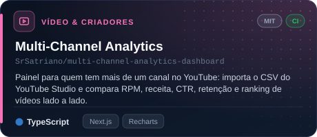</picture></a></td>
<td valign="top">

<h4><a href="https://github.com/SrSatriano/multi-channel-analytics-dashboard">Multi-Channel Analytics</a></h4>
<a href="https://github.com/SrSatriano/multi-channel-analytics-dashboard/actions/workflows/ci.yml"></a>  
<ul>
<li>Dados ficam só no navegador</li>
<li>Site estático, sem servidor e sem chave de API</li>
<li>Gráficos de receita, CTR e retenção</li>
</ul>
<sub><b>Stack:</b> <code>Next.js</code> <code>TypeScript</code> <code>Recharts</code></sub><br/>
<sub><a href="https://github.com/SrSatriano/multi-channel-analytics-dashboard">📂 Código</a> · <a href="https://github.com/SrSatriano/multi-channel-analytics-dashboard#readme">📖 README</a> · <a href="https://github.com/SrSatriano/multi-channel-analytics-dashboard/commits">🕒 Commits</a> · <a href="https://github.com/SrSatriano/multi-channel-analytics-dashboard/issues">💬 Issues</a></sub>

</td>
</tr>
<tr>
<td width="48%" valign="top"><a href="https://github.com/SrSatriano/omniforge-studio"><picture><source media="(prefers-color-scheme: dark)" srcset="assets/dark/cards/omniforge-studio.svg" /><source media="(prefers-color-scheme: light)" srcset="assets/light/cards/omniforge-studio.svg" />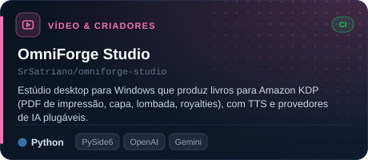</picture></a></td>
<td valign="top">

<h4><a href="https://github.com/SrSatriano/omniforge-studio">OmniForge Studio</a></h4>
<a href="https://github.com/SrSatriano/omniforge-studio/actions/workflows/ci.yml"></a> 
<ul>
<li>UI PySide6 que não trava: QThreadPool + ProcessPool</li>
<li>Chaves no DPAPI do Windows com AES-GCM</li>
<li>Mais de 1.000 testes com pytest</li>
</ul>
<sub><b>Stack:</b> <code>Python</code> <code>PySide6</code> <code>OpenAI</code> <code>Gemini</code></sub><br/>
<sub><a href="https://github.com/SrSatriano/omniforge-studio">📂 Código</a> · <a href="https://github.com/SrSatriano/omniforge-studio#readme">📖 README</a> · <a href="https://github.com/SrSatriano/omniforge-studio/commits">🕒 Commits</a> · <a href="https://github.com/SrSatriano/omniforge-studio/issues">💬 Issues</a></sub>

</td>
</tr>
<tr>
<td width="48%" valign="top"><a href="https://github.com/SrSatriano/autonomous-short-form-video-pipeline"><picture><source media="(prefers-color-scheme: dark)" srcset="assets/dark/cards/autonomous-short-form-video-pipeline.svg" /><source media="(prefers-color-scheme: light)" srcset="assets/light/cards/autonomous-short-form-video-pipeline.svg" />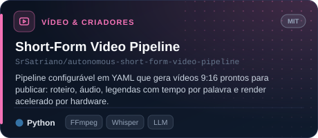</picture></a></td>
<td valign="top">

<h4><a href="https://github.com/SrSatriano/autonomous-short-form-video-pipeline">Short-Form Video Pipeline</a></h4>
 
<ul>
<li>Legendas ASS com word timing (Whisper)</li>
<li>NVENC, VideoToolbox e AMF</li>
<li>Métricas por estágio</li>
</ul>
<sub><b>Stack:</b> <code>Python</code> <code>FFmpeg</code> <code>Whisper</code> <code>LLM</code></sub><br/>
<sub><a href="https://github.com/SrSatriano/autonomous-short-form-video-pipeline">📂 Código</a> · <a href="https://github.com/SrSatriano/autonomous-short-form-video-pipeline#readme">📖 README</a> · <a href="https://github.com/SrSatriano/autonomous-short-form-video-pipeline/commits">🕒 Commits</a> · <a href="https://github.com/SrSatriano/autonomous-short-form-video-pipeline/issues">💬 Issues</a></sub>

</td>
</tr>
<tr>
<td width="48%" valign="top"><a href="https://github.com/SrSatriano/algorithmic-lofi-audio-generator"><picture><source media="(prefers-color-scheme: dark)" srcset="assets/dark/cards/algorithmic-lofi-audio-generator.svg" /><source media="(prefers-color-scheme: light)" srcset="assets/light/cards/algorithmic-lofi-audio-generator.svg" />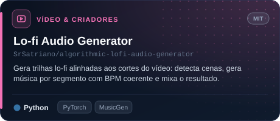</picture></a></td>
<td valign="top">

<h4><a href="https://github.com/SrSatriano/algorithmic-lofi-audio-generator">Lo-fi Audio Generator</a></h4>
 
<ul>
<li>Detecção de cenas</li>
<li>Geração por segmento com MusicGen</li>
<li>CLI vídeo → áudio</li>
</ul>
<sub><b>Stack:</b> <code>Python</code> <code>PyTorch</code> <code>MusicGen</code></sub><br/>
<sub><a href="https://github.com/SrSatriano/algorithmic-lofi-audio-generator">📂 Código</a> · <a href="https://github.com/SrSatriano/algorithmic-lofi-audio-generator#readme">📖 README</a> · <a href="https://github.com/SrSatriano/algorithmic-lofi-audio-generator/commits">🕒 Commits</a> · <a href="https://github.com/SrSatriano/algorithmic-lofi-audio-generator/issues">💬 Issues</a></sub>

</td>
</tr>
<tr>
<td width="48%" valign="top"><a href="https://github.com/SrSatriano/realtime-deepfake-streaming-bridge"><picture><source media="(prefers-color-scheme: dark)" srcset="assets/dark/cards/realtime-deepfake-streaming-bridge.svg" /><source media="(prefers-color-scheme: light)" srcset="assets/light/cards/realtime-deepfake-streaming-bridge.svg" />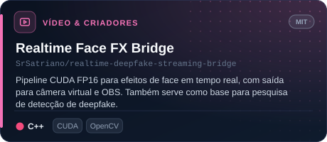</picture></a></td>
<td valign="top">

<h4><a href="https://github.com/SrSatriano/realtime-deepfake-streaming-bridge">Realtime Face FX Bridge</a></h4>
 
<ul>
<li>Pré-processamento em CUDA</li>
<li>Inferência FP16</li>
<li>Guia de VRAM e integração OBS</li>
</ul>
<sub><b>Stack:</b> <code>C++</code> <code>CUDA</code> <code>OpenCV</code></sub><br/>
<sub><a href="https://github.com/SrSatriano/realtime-deepfake-streaming-bridge">📂 Código</a> · <a href="https://github.com/SrSatriano/realtime-deepfake-streaming-bridge#readme">📖 README</a> · <a href="https://github.com/SrSatriano/realtime-deepfake-streaming-bridge/commits">🕒 Commits</a> · <a href="https://github.com/SrSatriano/realtime-deepfake-streaming-bridge/issues">💬 Issues</a></sub>

</td>
</tr>
<tr>
<td width="48%" valign="top"><a href="https://github.com/SrSatriano/satriano-studio"><picture><source media="(prefers-color-scheme: dark)" srcset="assets/dark/cards/satriano-studio.svg" /><source media="(prefers-color-scheme: light)" srcset="assets/light/cards/satriano-studio.svg" />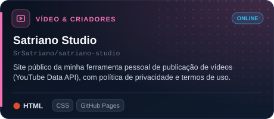</picture></a></td>
<td valign="top">

<h4><a href="https://github.com/SrSatriano/satriano-studio">Satriano Studio</a></h4>

<ul>
<li>Site estático no GitHub Pages</li>
<li>Páginas de privacidade e termos</li>
<li>HTML + CSS sem dependências</li>
</ul>
<sub><b>Stack:</b> <code>HTML</code> <code>CSS</code> <code>GitHub Pages</code></sub><br/>
<sub><a href="https://github.com/SrSatriano/satriano-studio">📂 Código</a> · <a href="https://github.com/SrSatriano/satriano-studio#readme">📖 README</a> · <a href="https://srsatriano.github.io/satriano-studio/">🌐 Site</a> · <a href="https://github.com/SrSatriano/satriano-studio/commits">🕒 Commits</a> · <a href="https://github.com/SrSatriano/satriano-studio/issues">💬 Issues</a></sub>

</td>
</tr>
</table>

</details>

<p align="right"><a href="#topo">⬆ voltar ao topo</a></p>

<a id="frente-product"></a>

<picture><source media="(prefers-color-scheme: dark)" srcset="assets/dark/sections/product.svg" /><source media="(prefers-color-scheme: light)" srcset="assets/light/sections/product.svg" />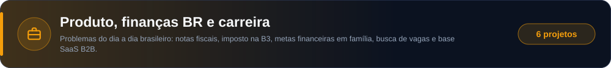</picture>

<details open>
<summary><b>🇧🇷 Produto, finanças BR e carreira: ver os 6 projetos</b></summary>
<br/>

<table>
<tr>
<td width="48%" valign="top"><a href="https://github.com/SrSatriano/fiscal-data-ocr-engine"><picture><source media="(prefers-color-scheme: dark)" srcset="assets/dark/cards/fiscal-data-ocr-engine.svg" /><source media="(prefers-color-scheme: light)" srcset="assets/light/cards/fiscal-data-ocr-engine.svg" /></picture></a></td>
<td valign="top">

<h4><a href="https://github.com/SrSatriano/fiscal-data-ocr-engine">Fiscal Data OCR</a></h4>
<a href="https://github.com/SrSatriano/fiscal-data-ocr-engine/actions/workflows/ci.yml"></a>  
<ul>
<li>Leitura completa da NF-e 4.00 (NCM, CFOP, itens)</li>
<li>OCR opcional para cupons fotografados</li>
<li>Planilha com total gasto por categoria</li>
</ul>
<sub><b>Stack:</b> <code>Python</code> <code>OCR</code> <code>XML</code> <code>PDF</code></sub><br/>
<sub><a href="https://github.com/SrSatriano/fiscal-data-ocr-engine">📂 Código</a> · <a href="https://github.com/SrSatriano/fiscal-data-ocr-engine#readme">📖 README</a> · <a href="https://github.com/SrSatriano/fiscal-data-ocr-engine/commits">🕒 Commits</a> · <a href="https://github.com/SrSatriano/fiscal-data-ocr-engine/issues">💬 Issues</a></sub>

</td>
</tr>
<tr>
<td width="48%" valign="top"><a href="https://github.com/SrSatriano/tax-loss-harvesting-engine"><picture><source media="(prefers-color-scheme: dark)" srcset="assets/dark/cards/tax-loss-harvesting-engine.svg" /><source media="(prefers-color-scheme: light)" srcset="assets/light/cards/tax-loss-harvesting-engine.svg" />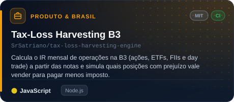</picture></a></td>
<td valign="top">

<h4><a href="https://github.com/SrSatriano/tax-loss-harvesting-engine">Tax-Loss Harvesting B3</a></h4>
<a href="https://github.com/SrSatriano/tax-loss-harvesting-engine/actions/workflows/ci.yml"></a>  
<ul>
<li>Regras da Lei 11.033/2004 e IN RFB 1.585/2015</li>
<li>Isenção de R$ 20 mil e compensação de prejuízo</li>
<li>Simulação, não aconselhamento tributário</li>
</ul>
<sub><b>Stack:</b> <code>Node.js</code> <code>JavaScript</code></sub><br/>
<sub><a href="https://github.com/SrSatriano/tax-loss-harvesting-engine">📂 Código</a> · <a href="https://github.com/SrSatriano/tax-loss-harvesting-engine#readme">📖 README</a> · <a href="https://github.com/SrSatriano/tax-loss-harvesting-engine/commits">🕒 Commits</a> · <a href="https://github.com/SrSatriano/tax-loss-harvesting-engine/issues">💬 Issues</a></sub>

</td>
</tr>
<tr>
<td width="48%" valign="top"><a href="https://github.com/SrSatriano/vagas-alerta"><picture><source media="(prefers-color-scheme: dark)" srcset="assets/dark/cards/vagas-alerta.svg" /><source media="(prefers-color-scheme: light)" srcset="assets/light/cards/vagas-alerta.svg" /></picture></a></td>
<td valign="top">

<h4><a href="https://github.com/SrSatriano/vagas-alerta">Vagas Alerta</a></h4>
<a href="https://github.com/SrSatriano/vagas-alerta/actions/workflows/ci.yml"></a> 
<ul>
<li>Deduplicação difusa com RapidFuzz</li>
<li>SQLite + FTS5, sem servidor de banco</li>
<li>Painel Next.js 15 e API FastAPI com worker agendado</li>
</ul>
<sub><b>Stack:</b> <code>Python</code> <code>FastAPI</code> <code>SQLite FTS5</code> <code>Next.js</code> <code>Telegram</code></sub><br/>
<sub><a href="https://github.com/SrSatriano/vagas-alerta">📂 Código</a> · <a href="https://github.com/SrSatriano/vagas-alerta#readme">📖 README</a> · <a href="https://github.com/SrSatriano/vagas-alerta/commits">🕒 Commits</a> · <a href="https://github.com/SrSatriano/vagas-alerta/issues">💬 Issues</a></sub>

</td>
</tr>
<tr>
<td width="48%" valign="top"><a href="https://github.com/SrSatriano/rotanorte"><picture><source media="(prefers-color-scheme: dark)" srcset="assets/dark/cards/rotanorte.svg" /><source media="(prefers-color-scheme: light)" srcset="assets/light/cards/rotanorte.svg" /></picture></a></td>
<td valign="top">

<h4><a href="https://github.com/SrSatriano/rotanorte">RotaNorte</a></h4>
<a href="https://github.com/SrSatriano/rotanorte/actions/workflows/ci.yml"></a> 
<ul>
<li>Listas LMIA, AIP e green card (PERM)</li>
<li>Currículo e carta em inglês por vaga, em PDF</li>
<li>Plano de ação e avisos no Telegram</li>
</ul>
<sub><b>Stack:</b> <code>Python</code> <code>SQLite</code> <code>Telegram</code></sub><br/>
<sub><a href="https://github.com/SrSatriano/rotanorte">📂 Código</a> · <a href="https://github.com/SrSatriano/rotanorte#readme">📖 README</a> · <a href="https://github.com/SrSatriano/rotanorte/commits">🕒 Commits</a> · <a href="https://github.com/SrSatriano/rotanorte/issues">💬 Issues</a></sub>

</td>
</tr>
<tr>
<td width="48%" valign="top"><a href="https://github.com/SrSatriano/family-treasury-dao-tracker"><picture><source media="(prefers-color-scheme: dark)" srcset="assets/dark/cards/family-treasury-dao-tracker.svg" /><source media="(prefers-color-scheme: light)" srcset="assets/light/cards/family-treasury-dao-tracker.svg" /></picture></a></td>
<td valign="top">

<h4><a href="https://github.com/SrSatriano/family-treasury-dao-tracker">Family Treasury</a></h4>
 
<ul>
<li>API REST de cofres e aportes</li>
<li>Projeção de valor futuro documentada</li>
<li>SQLite zero-config</li>
</ul>
<sub><b>Stack:</b> <code>React</code> <code>Vite</code> <code>Express</code> <code>SQLite</code></sub><br/>
<sub><a href="https://github.com/SrSatriano/family-treasury-dao-tracker">📂 Código</a> · <a href="https://github.com/SrSatriano/family-treasury-dao-tracker#readme">📖 README</a> · <a href="https://github.com/SrSatriano/family-treasury-dao-tracker/commits">🕒 Commits</a> · <a href="https://github.com/SrSatriano/family-treasury-dao-tracker/issues">💬 Issues</a></sub>

</td>
</tr>
<tr>
<td width="48%" valign="top"><a href="https://github.com/SrSatriano/enterprise-b2b-saas-boilerplate"><picture><source media="(prefers-color-scheme: dark)" srcset="assets/dark/cards/enterprise-b2b-saas-boilerplate.svg" /><source media="(prefers-color-scheme: light)" srcset="assets/light/cards/enterprise-b2b-saas-boilerplate.svg" /></picture></a></td>
<td valign="top">

<h4><a href="https://github.com/SrSatriano/enterprise-b2b-saas-boilerplate">B2B SaaS Boilerplate</a></h4>
 
<ul>
<li>RLS multi-tenant no Supabase</li>
<li>Middleware Next.js para rotas protegidas</li>
<li>Migrations SQL e webhooks Stripe</li>
</ul>
<sub><b>Stack:</b> <code>Next.js</code> <code>Supabase</code> <code>Stripe</code> <code>TypeScript</code></sub><br/>
<sub><a href="https://github.com/SrSatriano/enterprise-b2b-saas-boilerplate">📂 Código</a> · <a href="https://github.com/SrSatriano/enterprise-b2b-saas-boilerplate#readme">📖 README</a> · <a href="https://github.com/SrSatriano/enterprise-b2b-saas-boilerplate/commits">🕒 Commits</a> · <a href="https://github.com/SrSatriano/enterprise-b2b-saas-boilerplate/issues">💬 Issues</a></sub>

</td>
</tr>
</table>

</details>

<p align="right"><a href="#topo">⬆ voltar ao topo</a></p>

<a id="frente-web3"></a>

<picture><source media="(prefers-color-scheme: dark)" srcset="assets/dark/sections/web3.svg" /><source media="(prefers-color-scheme: light)" srcset="assets/light/sections/web3.svg" /></picture>

<details open>
<summary><b>⛓️ Web3, identidade e segurança on-chain: ver os 6 projetos</b></summary>
<br/>

<table>
<tr>
<td width="48%" valign="top"><a href="https://github.com/SrSatriano/tokenomics-staking-protocol"><picture><source media="(prefers-color-scheme: dark)" srcset="assets/dark/cards/tokenomics-staking-protocol.svg" /><source media="(prefers-color-scheme: light)" srcset="assets/light/cards/tokenomics-staking-protocol.svg" /></picture></a></td>
<td valign="top">

<h4><a href="https://github.com/SrSatriano/tokenomics-staking-protocol">Tokenomics &amp; Staking</a></h4>
 
<ul>
<li>Cobertura de testes acima de 90%</li>
<li>Deploy em Polygon Amoy</li>
<li>Tokenomics documentada</li>
</ul>
<sub><b>Stack:</b> <code>Solidity</code> <code>Hardhat</code> <code>OpenZeppelin</code> <code>React</code></sub><br/>
<sub><a href="https://github.com/SrSatriano/tokenomics-staking-protocol">📂 Código</a> · <a href="https://github.com/SrSatriano/tokenomics-staking-protocol#readme">📖 README</a> · <a href="https://github.com/SrSatriano/tokenomics-staking-protocol/commits">🕒 Commits</a> · <a href="https://github.com/SrSatriano/tokenomics-staking-protocol/issues">💬 Issues</a></sub>

</td>
</tr>
<tr>
<td width="48%" valign="top"><a href="https://github.com/SrSatriano/identity-vault-zk-proofs"><picture><source media="(prefers-color-scheme: dark)" srcset="assets/dark/cards/identity-vault-zk-proofs.svg" /><source media="(prefers-color-scheme: light)" srcset="assets/light/cards/identity-vault-zk-proofs.svg" /></picture></a></td>
<td valign="top">

<h4><a href="https://github.com/SrSatriano/identity-vault-zk-proofs">Identity Vault ZK</a></h4>
 
<ul>
<li>Circuito balance.circom</li>
<li>Contrato verificador on-chain</li>
<li>Deploy em Sepolia</li>
</ul>
<sub><b>Stack:</b> <code>Circom</code> <code>SnarkJS</code> <code>Solidity</code> <code>Hardhat</code></sub><br/>
<sub><a href="https://github.com/SrSatriano/identity-vault-zk-proofs">📂 Código</a> · <a href="https://github.com/SrSatriano/identity-vault-zk-proofs#readme">📖 README</a> · <a href="https://github.com/SrSatriano/identity-vault-zk-proofs/commits">🕒 Commits</a> · <a href="https://github.com/SrSatriano/identity-vault-zk-proofs/issues">💬 Issues</a></sub>

</td>
</tr>
<tr>
<td width="48%" valign="top"><a href="https://github.com/SrSatriano/p2p-orderbook-gossip"><picture><source media="(prefers-color-scheme: dark)" srcset="assets/dark/cards/p2p-orderbook-gossip.svg" /><source media="(prefers-color-scheme: light)" srcset="assets/light/cards/p2p-orderbook-gossip.svg" /></picture></a></td>
<td valign="top">

<h4><a href="https://github.com/SrSatriano/p2p-orderbook-gossip">P2P Order Book Gossip</a></h4>
 
<ul>
<li>GossipSub sobre libp2p</li>
<li>Rate limit contra DDoS</li>
<li>CLI para subir vários nós</li>
</ul>
<sub><b>Stack:</b> <code>Rust</code> <code>libp2p</code></sub><br/>
<sub><a href="https://github.com/SrSatriano/p2p-orderbook-gossip">📂 Código</a> · <a href="https://github.com/SrSatriano/p2p-orderbook-gossip#readme">📖 README</a> · <a href="https://github.com/SrSatriano/p2p-orderbook-gossip/commits">🕒 Commits</a> · <a href="https://github.com/SrSatriano/p2p-orderbook-gossip/issues">💬 Issues</a></sub>

</td>
</tr>
<tr>
<td width="48%" valign="top"><a href="https://github.com/SrSatriano/honeypot-rugpull-analyzer"><picture><source media="(prefers-color-scheme: dark)" srcset="assets/dark/cards/honeypot-rugpull-analyzer.svg" /><source media="(prefers-color-scheme: light)" srcset="assets/light/cards/honeypot-rugpull-analyzer.svg" /></picture></a></td>
<td valign="top">

<h4><a href="https://github.com/SrSatriano/honeypot-rugpull-analyzer">Honeypot &amp; Rug Pull Analyzer</a></h4>
 
<ul>
<li>Mais de 10 detectores</li>
<li>CLI por endereço de contrato</li>
<li>Menos de 8 s por análise na Ethereum</li>
</ul>
<sub><b>Stack:</b> <code>Python</code> <code>Slither</code> <code>Web3.py</code></sub><br/>
<sub><a href="https://github.com/SrSatriano/honeypot-rugpull-analyzer">📂 Código</a> · <a href="https://github.com/SrSatriano/honeypot-rugpull-analyzer#readme">📖 README</a> · <a href="https://github.com/SrSatriano/honeypot-rugpull-analyzer/commits">🕒 Commits</a> · <a href="https://github.com/SrSatriano/honeypot-rugpull-analyzer/issues">💬 Issues</a></sub>

</td>
</tr>
<tr>
<td width="48%" valign="top"><a href="https://github.com/SrSatriano/mempool-arbitrage-mev-bot"><picture><source media="(prefers-color-scheme: dark)" srcset="assets/dark/cards/mempool-arbitrage-mev-bot.svg" /><source media="(prefers-color-scheme: light)" srcset="assets/light/cards/mempool-arbitrage-mev-bot.svg" /></picture></a></td>
<td valign="top">

<h4><a href="https://github.com/SrSatriano/mempool-arbitrage-mev-bot">Mempool MEV Lab</a></h4>
 
<ul>
<li>Listener de transações pendentes</li>
<li>Simulador local de mempool</li>
<li>Avisos éticos e limitações documentados</li>
</ul>
<sub><b>Stack:</b> <code>Rust</code> <code>Tokio</code> <code>Web3</code></sub><br/>
<sub><a href="https://github.com/SrSatriano/mempool-arbitrage-mev-bot">📂 Código</a> · <a href="https://github.com/SrSatriano/mempool-arbitrage-mev-bot#readme">📖 README</a> · <a href="https://github.com/SrSatriano/mempool-arbitrage-mev-bot/commits">🕒 Commits</a> · <a href="https://github.com/SrSatriano/mempool-arbitrage-mev-bot/issues">💬 Issues</a></sub>

</td>
</tr>
<tr>
<td width="48%" valign="top"><a href="https://github.com/SrSatriano/cross-border-ledger-fabric"><picture><source media="(prefers-color-scheme: dark)" srcset="assets/dark/cards/cross-border-ledger-fabric.svg" /><source media="(prefers-color-scheme: light)" srcset="assets/light/cards/cross-border-ledger-fabric.svg" /></picture></a></td>
<td valign="top">

<h4><a href="https://github.com/SrSatriano/cross-border-ledger-fabric">Cross-Border Ledger</a></h4>
 
<ul>
<li>Chaincode de invoice em Go</li>
<li>Canais privados multi-org</li>
<li>Trilha imutável e auditável</li>
</ul>
<sub><b>Stack:</b> <code>Hyperledger Fabric</code> <code>Go</code> <code>Docker</code></sub><br/>
<sub><a href="https://github.com/SrSatriano/cross-border-ledger-fabric">📂 Código</a> · <a href="https://github.com/SrSatriano/cross-border-ledger-fabric#readme">📖 README</a> · <a href="https://github.com/SrSatriano/cross-border-ledger-fabric/commits">🕒 Commits</a> · <a href="https://github.com/SrSatriano/cross-border-ledger-fabric/issues">💬 Issues</a></sub>

</td>
</tr>
</table>

</details>

<p align="right"><a href="#topo">⬆ voltar ao topo</a></p>

<a id="frente-infra"></a>

<picture><source media="(prefers-color-scheme: dark)" srcset="assets/dark/sections/infra.svg" /><source media="(prefers-color-scheme: light)" srcset="assets/light/sections/infra.svg" /></picture>

<details open>
<summary><b>🛠️ Infraestrutura, sistemas e observabilidade: ver os 5 projetos</b></summary>
<br/>

<table>
<tr>
<td width="48%" valign="top"><a href="https://github.com/SrSatriano/high-compression-log-router"><picture><source media="(prefers-color-scheme: dark)" srcset="assets/dark/cards/high-compression-log-router.svg" /><source media="(prefers-color-scheme: light)" srcset="assets/light/cards/high-compression-log-router.svg" /></picture></a></td>
<td valign="top">

<h4><a href="https://github.com/SrSatriano/high-compression-log-router">logroute</a></h4>
<a href="https://github.com/SrSatriano/high-compression-log-router/actions/workflows/ci.yml"></a>  
<ul>
<li>Regras por nível, campo, texto ou regex</li>
<li>Segmentos Zstd com rotação por tamanho e idade</li>
<li>Consulta com filtro de tempo e nível</li>
</ul>
<sub><b>Stack:</b> <code>Rust</code> <code>Zstd</code> <code>CLI</code></sub><br/>
<sub><a href="https://github.com/SrSatriano/high-compression-log-router">📂 Código</a> · <a href="https://github.com/SrSatriano/high-compression-log-router#readme">📖 README</a> · <a href="https://github.com/SrSatriano/high-compression-log-router/commits">🕒 Commits</a> · <a href="https://github.com/SrSatriano/high-compression-log-router/issues">💬 Issues</a></sub>

</td>
</tr>
<tr>
<td width="48%" valign="top"><a href="https://github.com/SrSatriano/ebpf-latency-tracer-financial"><picture><source media="(prefers-color-scheme: dark)" srcset="assets/dark/cards/ebpf-latency-tracer-financial.svg" /><source media="(prefers-color-scheme: light)" srcset="assets/light/cards/ebpf-latency-tracer-financial.svg" /></picture></a></td>
<td valign="top">

<h4><a href="https://github.com/SrSatriano/ebpf-latency-tracer-financial">eBPF Latency Tracer</a></h4>
 
<ul>
<li>Histogramas agregados no kernel</li>
<li>Loader em Python</li>
<li>Dashboard Grafana + Docker Compose</li>
</ul>
<sub><b>Stack:</b> <code>eBPF (C)</code> <code>Python</code> <code>Prometheus</code> <code>Grafana</code></sub><br/>
<sub><a href="https://github.com/SrSatriano/ebpf-latency-tracer-financial">📂 Código</a> · <a href="https://github.com/SrSatriano/ebpf-latency-tracer-financial#readme">📖 README</a> · <a href="https://github.com/SrSatriano/ebpf-latency-tracer-financial/commits">🕒 Commits</a> · <a href="https://github.com/SrSatriano/ebpf-latency-tracer-financial/issues">💬 Issues</a></sub>

</td>
</tr>
<tr>
<td width="48%" valign="top"><a href="https://github.com/SrSatriano/gitops-infra-state-reconciler"><picture><source media="(prefers-color-scheme: dark)" srcset="assets/dark/cards/gitops-infra-state-reconciler.svg" /><source media="(prefers-color-scheme: light)" srcset="assets/light/cards/gitops-infra-state-reconciler.svg" /></picture></a></td>
<td valign="top">

<h4><a href="https://github.com/SrSatriano/gitops-infra-state-reconciler">GitOps Reconciler</a></h4>
 
<ul>
<li>Detector de divergência por hash</li>
<li>Webhook Git + loop configurável</li>
<li>Logs estruturados</li>
</ul>
<sub><b>Stack:</b> <code>Go</code> <code>Webhooks</code> <code>Ansible</code></sub><br/>
<sub><a href="https://github.com/SrSatriano/gitops-infra-state-reconciler">📂 Código</a> · <a href="https://github.com/SrSatriano/gitops-infra-state-reconciler#readme">📖 README</a> · <a href="https://github.com/SrSatriano/gitops-infra-state-reconciler/commits">🕒 Commits</a> · <a href="https://github.com/SrSatriano/gitops-infra-state-reconciler/issues">💬 Issues</a></sub>

</td>
</tr>
<tr>
<td width="48%" valign="top"><a href="https://github.com/SrSatriano/hypervisor-ai-isolation"><picture><source media="(prefers-color-scheme: dark)" srcset="assets/dark/cards/hypervisor-ai-isolation.svg" /><source media="(prefers-color-scheme: light)" srcset="assets/light/cards/hypervisor-ai-isolation.svg" /></picture></a></td>
<td valign="top">

<h4><a href="https://github.com/SrSatriano/hypervisor-ai-isolation">Hypervisor AI Isolation</a></h4>
 
<ul>
<li>Scaffold VMX/EPT</li>
<li>Scripts QEMU/KVM</li>
<li>Roadmap de hardening</li>
</ul>
<sub><b>Stack:</b> <code>Rust</code> <code>QEMU/KVM</code> <code>VT-x</code></sub><br/>
<sub><a href="https://github.com/SrSatriano/hypervisor-ai-isolation">📂 Código</a> · <a href="https://github.com/SrSatriano/hypervisor-ai-isolation#readme">📖 README</a> · <a href="https://github.com/SrSatriano/hypervisor-ai-isolation/commits">🕒 Commits</a> · <a href="https://github.com/SrSatriano/hypervisor-ai-isolation/issues">💬 Issues</a></sub>

</td>
</tr>
<tr>
<td width="48%" valign="top"><a href="https://github.com/SrSatriano/zero-to-hero-workstation-provisioner"><picture><source media="(prefers-color-scheme: dark)" srcset="assets/dark/cards/zero-to-hero-workstation-provisioner.svg" /><source media="(prefers-color-scheme: light)" srcset="assets/light/cards/zero-to-hero-workstation-provisioner.svg" /></picture></a></td>
<td valign="top">

<h4><a href="https://github.com/SrSatriano/zero-to-hero-workstation-provisioner">Workstation Provisioner</a></h4>
 
<ul>
<li>Roles modulares</li>
<li>group_vars customizável</li>
<li>Compatível com WSL2</li>
</ul>
<sub><b>Stack:</b> <code>Ansible</code> <code>Bash</code></sub><br/>
<sub><a href="https://github.com/SrSatriano/zero-to-hero-workstation-provisioner">📂 Código</a> · <a href="https://github.com/SrSatriano/zero-to-hero-workstation-provisioner#readme">📖 README</a> · <a href="https://github.com/SrSatriano/zero-to-hero-workstation-provisioner/commits">🕒 Commits</a> · <a href="https://github.com/SrSatriano/zero-to-hero-workstation-provisioner/issues">💬 Issues</a></sub>

</td>
</tr>
</table>

</details>

<p align="right"><a href="#topo">⬆ voltar ao topo</a></p>

<a id="frente-origins"></a>

<picture><source media="(prefers-color-scheme: dark)" srcset="assets/dark/sections/origins.svg" /><source media="(prefers-color-scheme: light)" srcset="assets/light/sections/origins.svg" /></picture>

<details open>
<summary><b>🌱 Origens, estudos e sites: ver os 5 projetos</b></summary>
<br/>

<table>
<tr>
<td width="48%" valign="top"><a href="https://github.com/SrSatriano/portfolio-matheus-satriano"><picture><source media="(prefers-color-scheme: dark)" srcset="assets/dark/cards/portfolio-matheus-satriano.svg" /><source media="(prefers-color-scheme: light)" srcset="assets/light/cards/portfolio-matheus-satriano.svg" /></picture></a></td>
<td valign="top">

<h4><a href="https://github.com/SrSatriano/portfolio-matheus-satriano">Portfólio</a></h4>

<ul>
<li>Campos visuais gerados em código</li>
<li>Sem vídeos de fundo</li>
<li>Publicado no GitHub Pages</li>
</ul>
<sub><b>Stack:</b> <code>Next.js</code> <code>TypeScript</code> <code>GitHub Pages</code></sub><br/>
<sub><a href="https://github.com/SrSatriano/portfolio-matheus-satriano">📂 Código</a> · <a href="https://github.com/SrSatriano/portfolio-matheus-satriano#readme">📖 README</a> · <a href="https://srsatriano.github.io/portfolio-matheus-satriano/">🌐 Site</a> · <a href="https://github.com/SrSatriano/portfolio-matheus-satriano/commits">🕒 Commits</a> · <a href="https://github.com/SrSatriano/portfolio-matheus-satriano/issues">💬 Issues</a></sub>

</td>
</tr>
<tr>
<td width="48%" valign="top"><a href="https://github.com/SrSatriano/IA-Financeira"><picture><source media="(prefers-color-scheme: dark)" srcset="assets/dark/cards/IA-Financeira.svg" /><source media="(prefers-color-scheme: light)" srcset="assets/light/cards/IA-Financeira.svg" /></picture></a></td>
<td valign="top">

<h4><a href="https://github.com/SrSatriano/IA-Financeira">IA Financeira</a></h4>

<ul>
<li>Dados via yfinance</li>
<li>Modelos com scikit-learn e TensorFlow</li>
<li>Interface PyQt5 com mplfinance</li>
</ul>
<sub><b>Stack:</b> <code>Python</code> <code>TensorFlow</code> <code>PyQt5</code></sub><br/>
<sub><a href="https://github.com/SrSatriano/IA-Financeira">📂 Código</a> · <a href="https://github.com/SrSatriano/IA-Financeira#readme">📖 README</a> · <a href="https://github.com/SrSatriano/IA-Financeira/commits">🕒 Commits</a> · <a href="https://github.com/SrSatriano/IA-Financeira/issues">💬 Issues</a></sub>

</td>
</tr>
<tr>
<td width="48%" valign="top"><a href="https://github.com/SrSatriano/PersonalAI"><picture><source media="(prefers-color-scheme: dark)" srcset="assets/dark/cards/PersonalAI.svg" /><source media="(prefers-color-scheme: light)" srcset="assets/light/cards/PersonalAI.svg" /></picture></a></td>
<td valign="top">

<h4><a href="https://github.com/SrSatriano/PersonalAI">PersonalAI</a></h4>
 
<ul>
<li>Respostas com GPT-2 (transformers)</li>
<li>Memória em SQLite</li>
<li>Interface tkinter</li>
</ul>
<sub><b>Stack:</b> <code>Python</code> <code>transformers</code> <code>SQLite</code></sub><br/>
<sub><a href="https://github.com/SrSatriano/PersonalAI">📂 Código</a> · <a href="https://github.com/SrSatriano/PersonalAI#readme">📖 README</a> · <a href="https://github.com/SrSatriano/PersonalAI/commits">🕒 Commits</a> · <a href="https://github.com/SrSatriano/PersonalAI/issues">💬 Issues</a></sub>

</td>
</tr>
<tr>
<td width="48%" valign="top"><a href="https://github.com/SrSatriano/calculadora-de-notas"><picture><source media="(prefers-color-scheme: dark)" srcset="assets/dark/cards/calculadora-de-notas.svg" /><source media="(prefers-color-scheme: light)" srcset="assets/light/cards/calculadora-de-notas.svg" /></picture></a></td>
<td valign="top">

<h4><a href="https://github.com/SrSatriano/calculadora-de-notas">Calculadora de Notas</a></h4>

<ul>
<li>Até 6 notas com pesos</li>
<li>Versão Java</li>
<li>Versão Python/tkinter</li>
</ul>
<sub><b>Stack:</b> <code>Java</code> <code>Python</code></sub><br/>
<sub><a href="https://github.com/SrSatriano/calculadora-de-notas">📂 Código</a> · <a href="https://github.com/SrSatriano/calculadora-de-notas#readme">📖 README</a> · <a href="https://github.com/SrSatriano/calculadora-de-notas/commits">🕒 Commits</a> · <a href="https://github.com/SrSatriano/calculadora-de-notas/issues">💬 Issues</a></sub>

</td>
</tr>
<tr>
<td width="48%" valign="top"><a href="https://github.com/SrSatriano/Python_Senac_RIo_On"><picture><source media="(prefers-color-scheme: dark)" srcset="assets/dark/cards/Python_Senac_RIo_On.svg" /><source media="(prefers-color-scheme: light)" srcset="assets/light/cards/Python_Senac_RIo_On.svg" /></picture></a></td>
<td valign="top">

<h4><a href="https://github.com/SrSatriano/Python_Senac_RIo_On">Python Senac Rio On</a></h4>

<ul>
<li>Pastas por aula</li>
<li>Exercícios de Python 3</li>
<li>Registro de estudo</li>
</ul>
<sub><b>Stack:</b> <code>Python</code></sub><br/>
<sub><a href="https://github.com/SrSatriano/Python_Senac_RIo_On">📂 Código</a> · <a href="https://github.com/SrSatriano/Python_Senac_RIo_On#readme">📖 README</a> · <a href="https://github.com/SrSatriano/Python_Senac_RIo_On/commits">🕒 Commits</a> · <a href="https://github.com/SrSatriano/Python_Senac_RIo_On/issues">💬 Issues</a></sub>

</td>
</tr>
</table>

</details>

<p align="right"><a href="#topo">⬆ voltar ao topo</a></p>


---

<a id="ecossistema"></a>

## 🔗 Mapa dos projetos

Cada frente orbita o LHN: os módulos isolam um problema (latência, risco, inferência, logs) para estudar e medir separado, e o que amadurece volta para o sistema principal.

<div align="center">

<picture><source media="(prefers-color-scheme: dark)" srcset="assets/dark/constellation.svg" /><source media="(prefers-color-scheme: light)" srcset="assets/light/constellation.svg" /></picture>

</div>

---

<a id="por-onde-comecar"></a>

## 🧑‍💻 Por onde começar

| Se você quer ver… | Comece por | Por quê |
|---|---|---|
| ⚡ **Performance e microestrutura** | [Order Book](https://github.com/SrSatriano/ultra-low-latency-order-book-engine) → [AVX-512 Pricing](https://github.com/SrSatriano/avx512-options-pricing-engine) | C++20 sem dependências, benchmarks e CI |
| 🌐 **Um produto web publicado** | [lhnnexus.com](https://lhnnexus.com/pt) → [Portfólio](https://github.com/SrSatriano/portfolio-matheus-satriano) | Next.js 15, i18n, CSP e deploy na Vercel |
| 🛰️ **Um sistema completo** | [LHN Sovereign V90](https://github.com/SrSatriano/LHN-V90-IA) → [LHN Android](https://github.com/SrSatriano/lhn-android-apps) | back-end, painel, risco, IA e app móvel |
| 🧠 **IA local e privacidade** | [Second Mind Vault](https://github.com/SrSatriano/local-rag-second-mind-vault) → [infergw](https://github.com/SrSatriano/distributed-ai-inference-cluster) | RAG com citações e gateway OpenAI-compatível |
| 🇧🇷 **Produto para o Brasil** | [Fiscal OCR](https://github.com/SrSatriano/fiscal-data-ocr-engine) → [Tax-Loss B3](https://github.com/SrSatriano/tax-loss-harvesting-engine) | NF-e, DANFE e imposto de renda na B3 |
| 🔔 **Ferramentas do dia a dia** | [Vagas Alerta](https://github.com/SrSatriano/vagas-alerta) → [RotaNorte](https://github.com/SrSatriano/rotanorte) | coleta, deduplicação, notas e alertas no Telegram |
| ✂️ **Cortes para criadores** | [CortaLive Básico](https://github.com/SrSatriano/CortaLive-Basico) → [CortaLive Pro](https://lhnnexus.com/pt/cortalive) | live gravada vira corte vertical com legenda e IA |
| 🎬 **Criação de conteúdo** | [VideoOS](https://github.com/SrSatriano/videoos) → [Channel Analytics](https://github.com/SrSatriano/multi-channel-analytics-dashboard) | edição em massa e métricas de canais |
| 🦀 **Rust e sistemas** | [logroute](https://github.com/SrSatriano/high-compression-log-router) → [Terminal TUI](https://github.com/SrSatriano/unified-trading-super-terminal) | Zstd, CLI, Ratatui e testes |
| ⛓️ **Web3** | [Identity Vault ZK](https://github.com/SrSatriano/identity-vault-zk-proofs) → [Honeypot Analyzer](https://github.com/SrSatriano/honeypot-rugpull-analyzer) | provas Groth16 e análise de contratos |

<details>
<summary><b>💡 Como rodar qualquer projeto</b></summary>

<br/>

Todos os repositórios têm README em português com pré-requisitos, instalação, configuração e testes. O caminho costuma ser o mesmo:

```bash
git clone https://github.com/SrSatriano/<repositorio>.git
cd <repositorio>
# siga a seção "Instalação e execução" do README
```

Projetos com selo **CI** rodam os testes a cada push; clique no selo para ver a última execução no GitHub Actions.

</details>

<a id="indice"></a>

<details>
<summary><b>📇 Índice A–Z: todos os 45 projetos em uma tabela</b></summary>

<br/>

| Projeto | Frente | Linguagem | O que é | Links |
|---|---|:---:|---|---|
| [LHN Sovereign V90](https://github.com/SrSatriano/LHN-V90-IA) | 📈 Quant & trading | Python | Meu terminal quantitativo local para cripto | [código](https://github.com/SrSatriano/LHN-V90-IA) |
| [LHN Android Apps](https://github.com/SrSatriano/lhn-android-apps) | 📈 Quant & trading | Kotlin | Dois apps Android nativos do ecossistema LHN | [código](https://github.com/SrSatriano/lhn-android-apps) · ✅ CI |
| [Order Book Engine](https://github.com/SrSatriano/ultra-low-latency-order-book-engine) | 📈 Quant & trading | C++ | Motor de matching em C++20 com prioridade preço-tempo, cinco tipos de ordem, replay de sessões em CSV e… | [código](https://github.com/SrSatriano/ultra-low-latency-order-book-engine) · ✅ CI |
| [AVX-512 Options Pricing](https://github.com/SrSatriano/avx512-options-pricing-engine) | 📈 Quant & trading | C++ | Precificação de opções europeias em C++20 | [código](https://github.com/SrSatriano/avx512-options-pricing-engine) · ✅ CI |
| [SMC Liquidity Scanner](https://github.com/SrSatriano/smc-liquidity-scanner) | 📈 Quant & trading | Python | Lê velas OHLC (CSV ou API pública da Bybit) e marca os conceitos de Smart Money | [código](https://github.com/SrSatriano/smc-liquidity-scanner) · ✅ CI |
| [Unified Trading Terminal](https://github.com/SrSatriano/unified-trading-super-terminal) | 📈 Quant & trading | Rust | Terminal de trading no console (TUI) com cotações ao vivo, gráfico, carteira com P&L, painel de risco com… | [código](https://github.com/SrSatriano/unified-trading-super-terminal) · ✅ CI |
| [Dark Pool Impact Simulator](https://github.com/SrSatriano/dark-pool-market-impact-simulator) | 📈 Quant & trading | Python | Simula o custo de executar um bloco grande com o modelo Almgren-Chriss, compara TWAP, VWAP e execução em… | [código](https://github.com/SrSatriano/dark-pool-market-impact-simulator) |
| [Chaos Trading Toolkit](https://github.com/SrSatriano/chaos-engineering-trading-toolkit) | 📈 Quant & trading | Go | Chaos engineering para bots de trading | [código](https://github.com/SrSatriano/chaos-engineering-trading-toolkit) |
| [Second Mind Vault](https://github.com/SrSatriano/local-rag-second-mind-vault) | 🧠 IA local | Python | Pergunte aos seus documentos sem mandar nada para a nuvem | [código](https://github.com/SrSatriano/local-rag-second-mind-vault) · ✅ CI |
| [infergw: Inference Gateway](https://github.com/SrSatriano/distributed-ai-inference-cluster) | 🧠 IA local | Python | Junta várias máquinas com LLMs (PC com GPU, notebook, servidor vLLM) atrás de um único endereço compatível… | [código](https://github.com/SrSatriano/distributed-ai-inference-cluster) · ✅ CI |
| [Loteria IA](https://github.com/SrSatriano/loteria-ia) | 🧠 IA local | Python | Explorador local das nove loterias numéricas da CAIXA | [código](https://github.com/SrSatriano/loteria-ia) · ✅ CI |
| [Hallucination Trap](https://github.com/SrSatriano/cognitive-bias-hallucination-trap) | 🧠 IA local | Python | Suíte de testes adversariais para LLMs | [código](https://github.com/SrSatriano/cognitive-bias-hallucination-trap) |
| [Voice Cloning TTS Gateway](https://github.com/SrSatriano/voice-cloning-tts-api-gateway) | 🧠 IA local | Python | API self-hosted de síntese e clonagem de voz | [código](https://github.com/SrSatriano/voice-cloning-tts-api-gateway) |
| [Viral Trend Predictor](https://github.com/SrSatriano/viral-trend-sentiment-predictor) | 🧠 IA local | Python | Cruza volume, sentimento e histórico para achar tendências cedo | [código](https://github.com/SrSatriano/viral-trend-sentiment-predictor) |
| [CortaLive Básico](https://github.com/SrSatriano/CortaLive-Basico) | 🎬 Vídeo & criadores | Python | 🔥 **Novo.** Versão 1.0.0, grátis e MIT | [código](https://github.com/SrSatriano/CortaLive-Basico) · [🌐](https://lhnnexus.com/pt/cortalive) |
| [CortaLive Pro](https://github.com/SrSatriano/CortaLive-Pro) | 🎬 Vídeo & criadores | Instalador | 🔥 **Novo.** A versão completa do CortaLive (instaladores; código fechado) | [código](https://github.com/SrSatriano/CortaLive-Pro) · [🌐](https://lhnnexus.com/pt/cortalive) |
| [VideoOS](https://github.com/SrSatriano/videoos) | 🎬 Vídeo & criadores | Python | Editor local-first de vídeos curtos verticais | [código](https://github.com/SrSatriano/videoos) · ✅ CI |
| [Multi-Channel Analytics](https://github.com/SrSatriano/multi-channel-analytics-dashboard) | 🎬 Vídeo & criadores | TypeScript | Painel para quem tem mais de um canal no YouTube | [código](https://github.com/SrSatriano/multi-channel-analytics-dashboard) · ✅ CI |
| [OmniForge Studio](https://github.com/SrSatriano/omniforge-studio) | 🎬 Vídeo & criadores | Python | Estúdio desktop para Windows que produz livros para Amazon KDP (PDF de impressão, capa, lombada,… | [código](https://github.com/SrSatriano/omniforge-studio) · ✅ CI |
| [Short-Form Video Pipeline](https://github.com/SrSatriano/autonomous-short-form-video-pipeline) | 🎬 Vídeo & criadores | Python | Pipeline configurável em YAML que gera vídeos 9:16 prontos para publicar | [código](https://github.com/SrSatriano/autonomous-short-form-video-pipeline) |
| [Lo-fi Audio Generator](https://github.com/SrSatriano/algorithmic-lofi-audio-generator) | 🎬 Vídeo & criadores | Python | Gera trilhas lo-fi alinhadas aos cortes do vídeo | [código](https://github.com/SrSatriano/algorithmic-lofi-audio-generator) |
| [Realtime Face FX Bridge](https://github.com/SrSatriano/realtime-deepfake-streaming-bridge) | 🎬 Vídeo & criadores | C++ | Pipeline CUDA FP16 para efeitos de face em tempo real, com saída para câmera virtual e OBS | [código](https://github.com/SrSatriano/realtime-deepfake-streaming-bridge) |
| [Satriano Studio](https://github.com/SrSatriano/satriano-studio) | 🎬 Vídeo & criadores | HTML | Site público da minha ferramenta pessoal de publicação de vídeos (YouTube Data API), com política de… | [código](https://github.com/SrSatriano/satriano-studio) · [🌐](https://srsatriano.github.io/satriano-studio/) |
| [Fiscal Data OCR](https://github.com/SrSatriano/fiscal-data-ocr-engine) | 🇧🇷 Produto & Brasil | Python | Extrai, valida e categoriza notas fiscais brasileiras | [código](https://github.com/SrSatriano/fiscal-data-ocr-engine) · ✅ CI |
| [Tax-Loss Harvesting B3](https://github.com/SrSatriano/tax-loss-harvesting-engine) | 🇧🇷 Produto & Brasil | JavaScript | Calcula o IR mensal de operações na B3 (ações, ETFs, FIIs e day trade) a partir das notas e simula quais… | [código](https://github.com/SrSatriano/tax-loss-harvesting-engine) · ✅ CI |
| [Vagas Alerta](https://github.com/SrSatriano/vagas-alerta) | 🇧🇷 Produto & Brasil | Python | Agregador local-first de vagas | [código](https://github.com/SrSatriano/vagas-alerta) · ✅ CI |
| [RotaNorte](https://github.com/SrSatriano/rotanorte) | 🇧🇷 Produto & Brasil | Python | Busca vagas com visto para EUA e Canadá em fontes oficiais (DOL, Job Bank, LMIA), dá nota de 0 a 100 para… | [código](https://github.com/SrSatriano/rotanorte) · ✅ CI |
| [Family Treasury](https://github.com/SrSatriano/family-treasury-dao-tracker) | 🇧🇷 Produto & Brasil | JavaScript | Tesouraria familiar | [código](https://github.com/SrSatriano/family-treasury-dao-tracker) |
| [B2B SaaS Boilerplate](https://github.com/SrSatriano/enterprise-b2b-saas-boilerplate) | 🇧🇷 Produto & Brasil | TypeScript | Base para SaaS B2B com o que todo projeto repete | [código](https://github.com/SrSatriano/enterprise-b2b-saas-boilerplate) |
| [Tokenomics & Staking](https://github.com/SrSatriano/tokenomics-staking-protocol) | ⛓️ Web3 | Solidity | Token ERC-20 com cap e burn e um StakingPool protegido contra reentrância, com testes Hardhat e deploy em… | [código](https://github.com/SrSatriano/tokenomics-staking-protocol) |
| [Identity Vault ZK](https://github.com/SrSatriano/identity-vault-zk-proofs) | ⛓️ Web3 | Solidity | Prova de saldo mínimo e KYC seletivo sem expor dados | [código](https://github.com/SrSatriano/identity-vault-zk-proofs) |
| [P2P Order Book Gossip](https://github.com/SrSatriano/p2p-orderbook-gossip) | ⛓️ Web3 | Rust | Order book descentralizado | [código](https://github.com/SrSatriano/p2p-orderbook-gossip) |
| [Honeypot & Rug Pull Analyzer](https://github.com/SrSatriano/honeypot-rugpull-analyzer) | ⛓️ Web3 | Python | Análise estática de contratos de token antes do swap | [código](https://github.com/SrSatriano/honeypot-rugpull-analyzer) |
| [Mempool MEV Lab](https://github.com/SrSatriano/mempool-arbitrage-mev-bot) | ⛓️ Web3 | Rust | Laboratório educacional de MEV | [código](https://github.com/SrSatriano/mempool-arbitrage-mev-bot) |
| [Cross-Border Ledger](https://github.com/SrSatriano/cross-border-ledger-fabric) | ⛓️ Web3 | Go | Ledger permissionado para faturas internacionais | [código](https://github.com/SrSatriano/cross-border-ledger-fabric) |
| [logroute](https://github.com/SrSatriano/high-compression-log-router) | 🛠️ Infra | Rust | Recebe logs JSON por TCP, HTTP, arquivo ou stdin, separa por regras e grava cada destino em segmentos Zstd… | [código](https://github.com/SrSatriano/high-compression-log-router) · ✅ CI |
| [eBPF Latency Tracer](https://github.com/SrSatriano/ebpf-latency-tracer-financial) | 🛠️ Infra | Python | Mede latência de rede no kernel sem o custo do tcpdump | [código](https://github.com/SrSatriano/ebpf-latency-tracer-financial) |
| [GitOps Reconciler](https://github.com/SrSatriano/gitops-infra-state-reconciler) | 🛠️ Infra | Go | Detecta quando um servidor diverge do Git | [código](https://github.com/SrSatriano/gitops-infra-state-reconciler) |
| [Hypervisor AI Isolation](https://github.com/SrSatriano/hypervisor-ai-isolation) | 🛠️ Infra | Rust | Isola agentes de IA em máquinas virtuais sem rede por padrão, para que tool-calling não exfiltre dados do host | [código](https://github.com/SrSatriano/hypervisor-ai-isolation) |
| [Workstation Provisioner](https://github.com/SrSatriano/zero-to-hero-workstation-provisioner) | 🛠️ Infra | Shell | Playbook Ansible idempotente que transforma uma máquina nova em estação de HFT/ML | [código](https://github.com/SrSatriano/zero-to-hero-workstation-provisioner) |
| [Portfólio](https://github.com/SrSatriano/portfolio-matheus-satriano) | 🌱 Origens | TypeScript | Site em Next.js que reúne o LHN e os módulos públicos, com estética de dossiê técnico, painéis de… | [código](https://github.com/SrSatriano/portfolio-matheus-satriano) · [🌐](https://srsatriano.github.io/portfolio-matheus-satriano/) |
| [IA Financeira](https://github.com/SrSatriano/IA-Financeira) | 🌱 Origens | Python | Um dos meus primeiros projetos | [código](https://github.com/SrSatriano/IA-Financeira) |
| [PersonalAI](https://github.com/SrSatriano/PersonalAI) | 🌱 Origens | Python | Chatbot pessoal com GPT-2 | [código](https://github.com/SrSatriano/PersonalAI) |
| [Calculadora de Notas](https://github.com/SrSatriano/calculadora-de-notas) | 🌱 Origens | Java | Calculadora de média ponderada para o semestre, com até seis notas e pesos, em duas versões | [código](https://github.com/SrSatriano/calculadora-de-notas) |
| [Python Senac Rio On](https://github.com/SrSatriano/Python_Senac_RIo_On) | 🌱 Origens | Python | Exercícios e códigos das aulas do curso de Python do Senac Rio, organizados por aula | [código](https://github.com/SrSatriano/Python_Senac_RIo_On) |

</details>

---

<a id="stack"></a>

## 🧰 Stack

<div align="center">

**Linguagens e core**

<picture>
  <source media="(prefers-color-scheme: light)" srcset="https://skillicons.dev/icons?i=python,rust,cpp,typescript,go,kotlin,java,javascript,solidity,bash&perline=10&theme=light" />
  
</picture>

<br/><br/>

**Web, APIs, mobile e dados**

<picture>
  <source media="(prefers-color-scheme: light)" srcset="https://skillicons.dev/icons?i=fastapi,nextjs,react,vite,tailwind,nodejs,androidstudio,postgres,sqlite,redis&perline=10&theme=light" />
  
</picture>

<br/><br/>

**IA e infraestrutura**

<picture>
  <source media="(prefers-color-scheme: light)" srcset="https://skillicons.dev/icons?i=tensorflow,pytorch,sklearn,docker,ansible,linux,githubactions,nginx,grafana,prometheus&perline=10&theme=light" />
  
</picture>

<br/><br/>


</div>

<details>
<summary><b>🧪 Como eu construo</b></summary>

<br/>

| Camada | Preferência técnica |
|---|---|
| **Core** | código mensurável, explícito e testável; benchmark antes de otimizar |
| **API** | contratos simples, FastAPI, OpenAPI e validação com Pydantic |
| **Interface** | Next.js, TUI em Rust, Jetpack Compose ou PySide6, conforme quem vai usar |
| **Dados** | SQLite (com FTS5 e WAL) quando basta, PostgreSQL e Redis quando a carga pede |
| **IA** | modelos open source, RAG offline, avaliação contra baseline e nada de promessa que o modelo não cumpre |
| **Operação** | logs úteis, health checks, Docker Compose, CI no GitHub Actions e README em português |

</details>

---

<a id="atividade"></a>

## 📈 Atividade

<div align="center">

<picture>
  <source media="(prefers-color-scheme: light)" srcset="https://github-profile-summary-cards.vercel.app/api/cards/profile-details?username=SrSatriano&theme=default" />
  
</picture>
<picture>
  <source media="(prefers-color-scheme: light)" srcset="https://github-profile-summary-cards.vercel.app/api/cards/repos-per-language?username=SrSatriano&theme=default" />
  
</picture>
<picture>
  <source media="(prefers-color-scheme: light)" srcset="https://streak-stats.demolab.com/?user=SrSatriano&theme=default&hide_border=true" />
  
</picture>

</div>

---

<a id="contato"></a>

## 📬 Contato

<div align="center">

<table>
  <tr><td align="center">🛰️</td><td><strong>LHN Nexus</strong></td><td><a href="https://lhnnexus.com/pt">lhnnexus.com</a></td></tr>
  <tr><td align="center">🌐</td><td><strong>Portfólio</strong></td><td><a href="https://srsatriano.github.io/portfolio-matheus-satriano/">srsatriano.github.io/portfolio-matheus-satriano</a></td></tr>
  <tr><td align="center">🎬</td><td><strong>Satriano Studio</strong></td><td><a href="https://srsatriano.github.io/satriano-studio/">srsatriano.github.io/satriano-studio</a></td></tr>
  <tr><td align="center">🐙</td><td><strong>GitHub</strong></td><td><a href="https://github.com/SrSatriano">github.com/SrSatriano</a></td></tr>
  <tr><td align="center">💼</td><td><strong>LinkedIn</strong></td><td><a href="https://www.linkedin.com/in/matheus-rodrigues-satriano">linkedin.com/in/matheus-rodrigues-satriano</a></td></tr>
  <tr><td align="center">🧑‍💻</td><td><strong>g.dev</strong></td><td><a href="https://g.dev/satriano">g.dev/satriano</a></td></tr>
  <tr><td align="center">✉️</td><td><strong>E-mail</strong></td><td><a href="mailto:matheussatriano@hotmail.com">matheussatriano@hotmail.com</a></td></tr>
</table>

<br/>

<a href="https://www.buymeacoffee.com/matheussatriano"></a>

<br/><br/>

**Disponível para oportunidades e parcerias em back-end, sistemas quantitativos, IA aplicada e produtos web, além de colaborações open source.**

<sub>Atualizado em 22 nov 2026 · visuais gerados por <a href="scripts/build_profile.py"><code>scripts/build_profile.py</code></a> a partir de <a href="data/projects.json"><code>data/projects.json</code></a> · tema claro e escuro automáticos</sub>

<br/><br/>

<a href="#topo">⬆ voltar ao topo</a>

<br/><br/>

<picture><source media="(prefers-color-scheme: dark)" srcset="assets/dark/footer.svg" /><source media="(prefers-color-scheme: light)" srcset="assets/light/footer.svg" /></picture>

</div>
